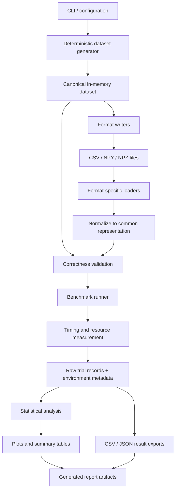
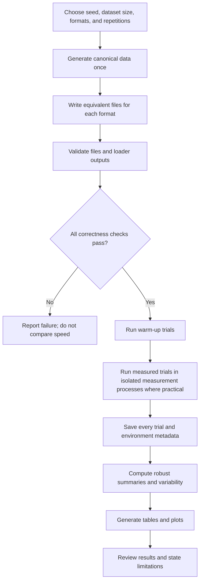

# Scientific Data Performance Lab

> **Status: Research and design specification — implementation not started.**  
> Commands and CLI examples marked **planned** describe the intended interface and will not work until the corresponding modules are implemented. No benchmark results are claimed in this repository yet.

A small, reproducible scientific-computing benchmark for understanding how data representation, serialization, parsing, compression, and preprocessing affect the time and memory needed to turn a dataset on disk into usable numerical arrays.

The first version deliberately compares **CSV with NumPy binary storage** using a deterministic synthetic dataset. It validates that each loader produces equivalent data, runs repeated trials, records environment metadata and raw measurements, and generates summaries and plots. JSON, HDF5, Apache Parquet, and CERN ROOT are researched as related formats, but are not required for the minimum viable product (MVP).

This is an independent educational project inspired by general scientific-computing challenges. It is **not affiliated with, endorsed by, or an official project of CERN or CERN-HSF**.

---

## Contents

- [Problem statement](#problem-statement)
- [Motivation and scientific relevance](#motivation-and-scientific-relevance)
- [Objectives and research questions](#objectives-and-research-questions)
- [Scope and target users](#scope-and-target-users)
- [Format background](#format-background)
- [MVP features and requirements](#mvp-features-and-requirements)
- [Architecture](#architecture)
- [Technology stack](#technology-stack)
- [System requirements](#system-requirements)
- [Installation on Ubuntu/Linux](#installation-on-ubuntulinux)
- [Configuration](#configuration)
- [Planned usage](#planned-usage)
- [Benchmark methodology](#benchmark-methodology)
- [Metrics and result formats](#metrics-and-result-formats)
- [Testing and correctness](#testing-and-correctness)
- [Planned repository structure](#planned-repository-structure)
- [Acceptance criteria and deliverables](#acceptance-criteria-and-deliverables)
- [Limitations and troubleshooting](#limitations-and-troubleshooting)
- [Development roadmap](#development-roadmap)
- [Contribution guidelines](#contribution-guidelines)
- [License guidance](#license-guidance)
- [References](#references)

---

## Problem statement

Scientific applications frequently read data from persistent storage, decode or parse it, convert it into suitable in-memory structures, and preprocess it before analysis. These stages can become bottlenecks when datasets grow or when the same data is repeatedly loaded.

A CSV file may be portable and easy to inspect, but representing numbers as text requires parsing and type conversion. A NumPy binary file can preserve array dtype and shape, avoiding text parsing, but has different portability and access trade-offs. Compressed storage can reduce disk I/O and file size while adding decompression work. The fastest option therefore depends on the workload and experimental conditions.

**Scientific Data Performance Lab** will provide a transparent way to measure these trade-offs on a developer's own machine, with correctness checks and enough metadata to interpret the results.

### The core comparison

For a fixed, reproducibly generated dataset:

1. Serialize equivalent data into CSV and NumPy-supported binary formats.
2. Measure storage size and write time separately.
3. Load each representation into a common in-memory structure.
4. validate the loaded data against the original dataset.
5. Measure loading and, separately, loading-plus-preprocessing.
6. Repeat trials, preserve raw observations, summarize variability, and plot the results.

The benchmark is intended to teach sound measurement practices, not to prove that one format is always best.

## Motivation and scientific relevance

In scientific computing, data pipelines sit between data acquisition/storage and analysis. Inefficient parsing, unnecessary conversions, poor memory behavior, or reading much more data than an analysis needs can consume time and resources that would otherwise be available for scientific work.

This is relevant to high-energy physics, astronomy, simulation, laboratory measurements, and data-intensive engineering. CERN's ROOT framework is an established example of scientific software that provides storage, I/O, analysis, and visualization facilities for high-energy physics. ROOT supports columnar datasets and workflows that can read selected columns, which is important when an analysis does not need every field.

This project does **not** attempt to reproduce CERN-scale workloads or benchmark ROOT in its MVP. Instead, it builds foundational skills that transfer to scientific software work:

- designing controlled experiments;
- understanding serialization and in-memory representations;
- measuring time, throughput, storage, and process memory;
- checking numerical correctness before comparing speed;
- reporting results with uncertainty and environmental context;
- distinguishing a local microbenchmark from a representative production workload.

## Objectives and research questions

### Objectives

- Generate deterministic, configurable datasets with known shapes, dtypes, and values.
- Store the same logical dataset in CSV and NumPy binary representations.
- Implement small, format-specific loaders behind a common interface.
- Verify that every loader preserves the intended values, shapes, columns, and dtypes.
- Measure writing, loading, and end-to-end load-plus-preprocess costs separately.
- Record per-trial measurements and system metadata in machine-readable files.
- Summarize repeated measurements using robust statistics and visualize them.
- Document limitations so results are interpretable and repeatable.

### Research questions

1. How do CSV and NumPy binary representations differ in full-dataset load time?
2. How do dataset row count, column count, dtype, and value distribution affect the results?
3. How much time is spent loading/parsing versus applying the same preprocessing operation?
4. How do file size and compression affect the time and resources required to load data?
5. What are the peak process-memory differences between the tested approaches?
6. How much do measurements vary across repeated trials on the same machine?
7. Under which conditions does one representation outperform another, and when does the result change?
8. Do the conclusions change when measuring a full load-and-preprocess workflow rather than loading alone?

These questions will be answered only after actual runs. The README must not contain invented timings or a preselected winner.

## Scope and target users

### MVP scope

The first milestone focuses on a deterministic, numeric, tabular dataset and a full-dataset read workload.

**Initial format variants:**

- **CSV**: readable text with explicit parsing and dtype conversion.
- **NumPy `.npy`**: one array stored in NumPy's binary format; useful for measuring binary array loading without an archive.
- **NumPy `.npz`**: an archive of `.npy` arrays, with uncompressed and compressed variants if the implementation can keep the comparison clear.

The minimum meaningful comparison is CSV versus `.npy`/`.npz`. The implementation should begin with the simplest reliable variants and add the compressed/uncompressed distinction as a clearly named experimental factor rather than silently mixing it into “format.”

The dataset should contain several numeric columns with documented dtypes. A practical baseline is a table represented as named arrays, for example `event_id` (integer), `measurement_a` and `measurement_b` (floating point), and `category_code` (small integer). All formats must represent the same logical rows and values.

### Explicit non-goals for the MVP

- Claiming results representative of all scientific data or CERN production workloads.
- Benchmarking distributed storage, cloud object stores, network filesystems, or clusters.
- Building a database, dashboard service, or general-purpose data platform.
- Implementing ROOT, HDF5, or Parquet support before the basic experiment is correct.
- GPU acceleration, parallel/distributed execution, or multi-node benchmarks.
- Supporting arbitrary nested or object-valued Python arrays.
- Claiming cold-cache results unless cache state is controlled and documented.
- Optimizing one format with custom code while leaving another on an intentionally poor path.
- Publishing universal format rankings from one machine or one synthetic dataset.

### Target users

- Students learning scientific Python and performance measurement.
- Developers comparing storage choices for numerical pipelines.
- Researchers who want a small, auditable baseline before designing a workload-specific benchmark.
- Contributors interested in scientific software, data I/O, testing, and reproducibility.

## Format background

The table below summarizes general properties, not a performance ranking. Actual performance must be measured for a defined workload.

| Format | Representation and strengths | Trade-offs and access pattern | MVP status |
|---|---|---|---|
| **CSV** | Text rows and delimiters; human-readable, easy to exchange, supported by many tools. | Numeric values must be parsed from text and types inferred or specified. Usually read as records/rows; efficient typed partial-column reads are less natural than in columnar formats. | **Required** |
| **JSON** | Text representation for structured objects; useful for metadata, nested records, APIs, and interoperability. | Field names and structural punctuation add overhead; numeric arrays are not stored as compact native numeric buffers by default. Parsing nested structures can be expensive. | Research only; not in MVP |
| **NumPy `.npy`** | Binary representation for a single array, preserving dtype and shape metadata. | Excellent fit for homogeneous numerical arrays; not a general table/relational format. Memory mapping can be useful for compatible uncompressed `.npy` arrays, but it changes the access workload. | **Required candidate** |
| **NumPy `.npz`** | ZIP archive containing named `.npy` arrays; can be uncompressed or compressed. Convenient for a small collection of arrays. | Archive handling and optional decompression add work. Loading an archive is not equivalent to memory-mapping a standalone `.npy` array. | **Required candidate** |
| **HDF5** | Hierarchical container for datasets and metadata; supports typed datasets, chunking, compression, and partial I/O. | Chunk layout and compression settings matter; performance depends on how reads align with chunks and the requested access pattern. | Future extension |
| **Apache Parquet** | Open, column-oriented format with encodings, compression, metadata, and row groups; readers can select columns. | Adds a dependency and introduces schema, row-group, and encoding choices. Stronger fit for columnar/tabular analytical workloads than for a single simple NumPy array. | Future extension |
| **ROOT** | Scientific data-analysis framework and file ecosystem used in high-energy physics; supports objects and columnar datasets and integrates with analysis tools such as RDataFrame. | Requires a separate ROOT installation and its own data model and APIs; comparison should use a realistic HEP-oriented workload, not simply substitute a `.root` extension into this benchmark. | Future, separate experiment |

### Important comparison caveats

- **CSV vs `.npy` is not a format-only comparison.** It also compares text parsing and conversion with binary array loading. That is a useful end-to-end question, but the report must say so.
- **`.npz` compression is a separate variable.** Compare compressed and uncompressed variants explicitly.
- **Parquet's column selection is a different workload** from loading an entire table. A future experiment should include both full-table reads and selected-column reads.
- **HDF5 chunking matters.** A single full-dataset scan and repeated small slices can favor different chunk layouts.
- **JSON should be tested with a well-defined schema.** JSON objects and flat numeric arrays are not interchangeable workloads.
- **ROOT should be compared in a scientific analysis context**, ideally using a documented tree/column schema and a workload that reflects HEP data access.

## MVP features and requirements

### Functional requirements

| ID | Requirement | Acceptance condition |
|---|---|---|
| FR-01 | Deterministic dataset generation | Same seed and configuration produce equivalent values and schema. |
| FR-02 | Multiple format writers | Every enabled format stores the same logical dataset. |
| FR-03 | Common loader contract | Each loader returns a normalized representation with documented dtypes and shape. |
| FR-04 | Correctness validation | Values, row count, column names, shape, and dtypes are checked before performance results are accepted. |
| FR-05 | Repeated benchmark trials | Warm-up and measured iterations are configurable and each trial is recorded. |
| FR-06 | Separate timing phases | Write, load-only, preprocess-only where meaningful, and load-plus-preprocess are reported separately. |
| FR-07 | Resource and size metrics | File size and elapsed time are recorded; peak RSS is collected where supported by the measurement method. |
| FR-08 | Raw result persistence | Every trial and its configuration are saved to CSV or JSON. |
| FR-09 | Statistical summary | Median, mean, standard deviation, minimum, maximum, and interquartile range are available; interpretation emphasizes median and spread. |
| FR-10 | Visualization | Generate readable comparisons for time, throughput, size, and memory where data is available. |
| FR-11 | Environment metadata | Capture Python and dependency versions, OS/platform, CPU description where available, seed, dataset configuration, and benchmark settings. |
| FR-12 | Automated tests | Unit and integration tests cover generation, serialization, loaders, correctness, and result schema. |

### Non-functional requirements

- **Reproducibility:** configuration and random seed are stored with each run.
- **Correctness first:** a loader that fails validation must not be included in a speed comparison.
- **Transparency:** raw measurements are retained; summaries never replace raw trials.
- **Modularity:** adding a format should not require rewriting the benchmark runner.
- **Portability:** core functionality should run on supported Linux, macOS, and Windows Python environments where dependencies permit; Ubuntu/Linux is the primary development target.
- **Safety:** NumPy loading should use `allow_pickle=False` for this numeric-only project.
- **Resource awareness:** dataset sizes should be configurable and safe defaults should work on a laptop.
- **Honest reporting:** distinguish measured facts, design assumptions, and future work.

## Architecture

### Component architecture



### End-to-end workflow



### Benchmark execution phases

The implementation should distinguish these phases rather than combine everything into one unexplained number:

1. **Dataset generation** — create the canonical arrays; excluded from format read timings.
2. **Serialization/write** — write the canonical data to a format; report separately.
3. **Load-only** — start from an existing file and produce the normalized in-memory representation.
4. **Preprocessing-only** — apply a documented deterministic transformation to an already loaded dataset.
5. **End-to-end** — load and apply the same transformation.
6. **Validation** — correctness checks occur before measured comparisons or outside the timed section unless validation itself is the explicit workload.

A future extension may include partial-column and chunked reads, but those must be reported as distinct workloads.

## Technology stack

| Technology | Role | MVP decision |
|---|---|---|
| **Python 3.11+** | Orchestration, CLI, experiment configuration, result processing | Required; use a supported stable Python release and record exact version |
| **NumPy** | Deterministic numeric arrays, `.npy`/`.npz` I/O, numerical checks | Required |
| **Python standard library** | `argparse`, `csv`, `json`, `pathlib`, `platform`, `time`, `statistics`, `resource` where available | Required; avoid dependencies when standard modules suffice |
| **pytest** | Unit and integration tests | Required for development |
| **Matplotlib** | Static plots of timing, throughput, size, and memory | Required for report generation |
| **psutil** | Optional process/system metadata and sampled RSS measurements | Optional; document its measurement limitations |
| **pandas** | Convenient tabular result analysis and CSV parsing baseline | Optional initially; do not add it merely for convenience if `csv` and NumPy are sufficient |
| **PyArrow** | Parquet read/write and Arrow tables | Future extension; adds a comparatively substantial dependency |
| **h5py** | HDF5 support | Future extension |
| **ROOT / PyROOT** | HEP-oriented storage and analysis experiment | Future extension; install separately following ROOT's official instructions |
| **pyperf** | More rigorous Python microbenchmarking and system-noise diagnostics | Optional future enhancement; initial runner can use `time.perf_counter_ns()` with repeated trials |

### Why not add every library now?

The MVP's value is a clean experimental design, validated loaders, and trustworthy results—not the number of dependencies. CSV, NumPy, tests, plots, and robust metadata are enough to build the first end-to-end experiment. Add pandas only if it represents a deliberately chosen CSV loading path; add PyArrow, h5py, or ROOT only when the corresponding experiment is specified.

## System requirements

### Minimum development environment

- Ubuntu 22.04+ or another modern Linux distribution (Ubuntu is the primary target).
- Python 3.11 or newer, ideally from a currently supported release.
- `python3-venv` and `python3-pip`.
- Enough free disk space for generated datasets and result artifacts.
- RAM sufficient for the selected dataset and its in-memory representation. Start small and scale gradually.

The project should also be portable to other operating systems, but timing comparisons across operating systems or machines should be treated as separate experimental environments.

### Ubuntu/Linux prerequisites

```bash
sudo apt update
sudo apt install -y python3 python3-venv python3-pip git
python3 --version
git --version
```

Do not run large datasets on a machine that is already memory-constrained. Begin with a small row count and increase it only after confirming that generation and loading complete comfortably.

## Installation on Ubuntu/Linux

> **Planned setup:** these commands describe the intended repository workflow. They become runnable after the files and dependency configuration are added.

```bash
git clone <YOUR_REPOSITORY_URL>
cd scientific-data-performance-lab

python3 -m venv .venv
source .venv/bin/activate

python -m pip install --upgrade pip
python -m pip install -e ".[dev]"
```

The repository should eventually provide a `pyproject.toml` with the runtime dependencies and a `dev` extra for pytest and development tooling. Until that file exists, an initial manual install can use:

```bash
python -m pip install numpy matplotlib pytest
# Optional resource sampling:
python -m pip install psutil
```

Check the environment:

```bash
python --version
python -m pip show numpy matplotlib pytest
python -m pytest
```

The final command is expected to run after tests are implemented. At the planning stage, there may be no tests to discover yet.

### Suggested `.gitignore`

```gitignore
.venv/
__pycache__/
.pytest_cache/
*.py[cod]
build/
dist/
*.egg-info/

# Generated data and benchmark outputs (keep small curated examples only)
data/generated/
results/raw/
results/plots/
results/reports/

# Editor / OS files
.vscode/
.idea/
.DS_Store
```

Keep generated data out of Git by default. If example results are committed later, label them with the exact environment and command used to generate them.

## Configuration

The benchmark should use a validated configuration object or CLI flags. The configuration must be stored with every run.

### Proposed configuration fields

| Setting | Example default | Purpose |
|---|---:|---|
| `seed` | `20261013` | Reproducible synthetic data |
| `rows` | `100000` | Dataset row count; choose smaller defaults if necessary |
| `formats` | `csv,npy,npz` | Explicit format variants to test |
| `repeats` | `7` | Number of measured trials per variant and workload |
| `warmups` | `2` | Warm-up trials excluded from summary |
| `compression` | `none` or `deflate` | Explicit NPZ compression variant |
| `preprocess` | `standardize` | Example deterministic operation, defined precisely |
| `output_dir` | `results/` | Destination for trial records and reports |
| `memory_measurement` | `peak_rss` where supported | Measurement method; metadata must state how it was collected |

The values above are proposed defaults, not measured or validated performance recommendations. A CLI should reject invalid row counts, unknown formats, negative repeats, and incompatible options with clear messages.

## Planned usage

The CLI interface below is a proposal for consistency. **These commands are not implemented yet.** The eventual implementation should keep the interface documented and covered by CLI tests.

### 1. Generate a small dataset

```bash
python -m sdpl.cli generate \
  --rows 100000 \
  --seed 20261013 \
  --output-dir data/generated
```

Expected behavior: generate one canonical logical dataset and metadata describing columns, dtypes, row count, and seed.

### 2. Write supported formats

```bash
python -m sdpl.cli convert \
  --input-dir data/generated \
  --formats csv,npy,npz \
  --output-dir data/serialized
```

Expected behavior: write the same logical dataset in each requested format and record write duration and file size. If `.npz` compression variants are supported, they should be named separately.

### 3. Run the benchmark

```bash
python -m sdpl.cli benchmark \
  --data-dir data/serialized \
  --formats csv,npy,npz \
  --workloads load,load-preprocess \
  --warmups 2 \
  --repeats 7 \
  --output-dir results/run-001
```

Expected behavior: validate each format first; run the requested workloads; save per-trial observations and metadata; generate a summary. The runner must fail clearly if a requested format has not been generated.

### 4. Generate visualizations from saved results

```bash
python -m sdpl.cli report \
  --results results/run-001/trials.csv \
  --output-dir results/run-001/report
```

Expected behavior: read saved observations and generate plots and a summary without re-running the benchmark.

### 5. Run tests

```bash
python -m pytest -q
```

The exact command names and flags can change during implementation, but README examples, CLI help, and tests must agree before release.

## Benchmark methodology

A benchmark is only meaningful when the workload and experimental conditions are explicit. The project should adopt the following protocol.

### 1. Define the workload before measuring

- Generate the canonical dataset once per configuration.
- Fix row count, columns, dtypes, seed, value distribution, and missing-value policy.
- Use the same logical data for every format.
- Define precisely what “load” means: returned type, dtype conversion, and normalization included or excluded.
- Define preprocessing as a deterministic operation with identical semantics across formats.
- Use a full-dataset read as the first workload; do not mix in partial reads until a separate experiment is defined.

### 2. Separate costs

Report serialization time, load-only time, preprocessing time where it can be isolated fairly, and end-to-end load-plus-preprocessing time separately. Dataset generation, correctness validation, plotting, and report generation should not accidentally fall inside the timed load region.

If a format needs a conversion to the canonical in-memory representation, that conversion is part of the load path and should be documented. Do not compare a raw array from one loader with a fully normalized table from another without explaining the difference.

### 3. Control experimental variables

The runner and report should record and control, as far as practical:

- **Dataset:** fixed seed, same row count and logical values, same column order and data types.
- **Software:** Python version, dependency versions, implementation options, compression settings, and loader configuration.
- **Hardware and OS:** operating system/kernel, CPU model where available, RAM where available, architecture, and filesystem location.
- **Machine load:** close unrelated heavy applications; avoid concurrent builds, downloads, or large jobs. Record that background load cannot be perfectly eliminated.
- **Power and thermal state:** use a stable power profile where possible, keep the machine ventilated, and avoid interpreting runs affected by thermal throttling as clean comparisons.
- **Trial order:** rotate or randomize format order across repetitions when practical to reduce systematic bias from temperature or background changes.
- **Warm-up:** run configurable unmeasured warm-ups, but report that warm-ups do not guarantee a cold or warm filesystem cache state.
- **Cache state:** use a clearly named **ordinary/warm-cache** experiment as the portable baseline. Do not claim a cold-cache benchmark just because the process was restarted. Reliably clearing OS page caches is privileged, system-wide, and platform-specific; it should not be part of the default run.
- **Process isolation:** where feasible, measure each trial in a fresh subprocess so previous allocations and process high-water marks do not contaminate the next trial. Process startup overhead must either be excluded from the timed region or reported as part of an explicitly defined end-to-end metric.
- **Timing boundaries:** use `time.perf_counter_ns()` around only the operation being measured. It is a high-resolution elapsed-time counter; only differences between readings are meaningful.
- **Correctness:** run validation before accepting results. A faster result is invalid if it returns different values or silently drops data.
- **Failures and outliers:** preserve raw observations and failed runs. Do not silently delete inconvenient outliers; investigate them and explain any exclusion rule.
- **Repeat count:** use several repetitions (initial proposal: seven measured trials after two warm-ups) and report spread, not only the fastest observation.
- **Disk state:** record filesystem and storage location. Avoid mixing network and local filesystems in one comparison.
- **Compression:** label compression method and level as part of the variant, not as a hidden setting.

These controls reduce confounding; they cannot make two different formats identical in all respects. The goal is a fair, transparent workload comparison, not laboratory-grade isolation on every consumer machine.

### 4. Measure memory carefully

Peak memory is difficult to infer from a single instantaneous RSS sample. Prefer one isolated process per trial and a documented high-water measurement where the platform exposes it, or sample RSS at a defined interval using `psutil`. Report the method, units, platform limitations, and whether the value is a process peak, sampled peak, or a delta from baseline.

Do not label a sampled RSS maximum as exact peak memory. Do not compare memory figures produced by different measurement methods in one unqualified chart.

### 5. Analyze repeated trials

For each combination of format, workload, and dataset configuration, retain every measured trial. Report at least:

- median elapsed time;
- mean elapsed time;
- standard deviation;
- minimum and maximum;
- interquartile range (IQR);
- number of successful trials;
- a clear indication of failed or excluded trials.

Use the **median** as the primary headline for noisy local measurements and show variability. Do not report more decimal places than the timing and workload justify. Avoid asserting statistical significance unless an appropriate statistical procedure is added and documented.

### 6. Define throughput

For a full-dataset read, a simple effective throughput is:

`effective_read_throughput_bytes_per_second = logical_input_bytes / load_elapsed_seconds`

The logical input size must be defined consistently (for example, the canonical array payload size). It is **not** the same as on-disk bytes read, especially for compressed formats. If throughput is calculated using on-disk file size, label it `file_bytes_per_second` instead. Never compare these two definitions as if they were equivalent.

### 7. Interpret results in context

- Smaller files can reduce storage and I/O but may need more CPU time for decompression.
- Binary formats can avoid text parsing, but the result depends on array layout, data conversion, cache state, and implementation.
- Columnar formats may be advantageous when reading only a subset of columns; that is a different experiment from loading every column.
- Synthetic numeric data makes the experiment repeatable but may not represent real scientific distributions, missing values, nested records, or irregular events.
- Results from one laptop should not be generalized to clusters or production facilities.

## Metrics and result formats

### Core metrics

| Metric | Definition | Notes |
|---|---|---|
| `elapsed_seconds` | Monotonic wall-clock duration for the named phase | Use `perf_counter_ns()` internally; convert for reporting |
| `write_seconds` | Duration to serialize the canonical data | Report separately from reading |
| `file_size_bytes` | On-disk size of the serialized file(s) | Include all files needed for that format |
| `logical_bytes` | Defined in-memory payload size for the canonical dataset | State whether metadata/array overhead is excluded |
| `effective_read_bytes_per_second` | `logical_bytes / load_seconds` | Represents logical payload throughput |
| `file_bytes_per_second` | `file_size_bytes / load_seconds` | Different interpretation; label explicitly |
| `peak_rss_bytes` | Process peak resident set size if reliably available | Record measurement method and platform |
| `rss_delta_bytes` | RSS after operation minus baseline RSS | Optional; not a substitute for peak RSS |
| `rows_per_second` | Rows loaded divided by elapsed time | Only compare same row-level workload |
| `correctness_passed` | Whether the loaded output passed equivalence checks | Failed variants must not enter speed ranking |
| `trial_index` | Repetition index | Preserve raw trial data |
| `run_id` | Unique identifier for a benchmark invocation | Connects trials to configuration and environment |

### Proposed raw trial CSV schema

This is an example schema, not a record of actual results:

```csv
run_id,format,compression,workload,rows,seed,trial_index,elapsed_seconds,write_seconds,file_size_bytes,logical_bytes,peak_rss_bytes,measurement_method,correctness_passed
example-run,csv,none,load,100000,20261013,1,,,,,,subprocess_peak_rss,true
```

Fields unavailable for a particular trial should be empty/null rather than fabricated. In a real run, `elapsed_seconds`, `file_size_bytes`, and relevant metadata must be populated. Write time can be stored in a separate serialization table if it does not naturally belong to each load trial.

### Proposed run metadata JSON

```json
{
  "run_id": "example-run",
  "status": "schema-example-not-a-real-run",
  "created_at_utc": null,
  "seed": 20261013,
  "dataset": {
    "rows": 100000,
    "columns": ["event_id", "measurement_a", "measurement_b", "category_code"],
    "dtypes": ["int64", "float64", "float64", "int16"]
  },
  "benchmark": {
    "warmups": 2,
    "repeats": 7,
    "cache_policy": "ordinary-filesystem-cache",
    "timing_clock": "time.perf_counter_ns",
    "memory_method": "record-the-actual-method"
  },
  "environment": {
    "python": null,
    "platform": null,
    "cpu": null,
    "ram_bytes": null,
    "dependencies": {}
  },
  "note": "Illustrative schema only; not measured data."
}
```

The schema should be versioned when it changes. Metadata should capture enough information to rerun an experiment, while avoiding assumptions that every platform exposes the same hardware details.

### Planned visualizations

- **Load-time comparison:** median time by format and workload, with individual trial points or variability bars.
- **Throughput comparison:** clearly labeled logical-payload or file-byte throughput.
- **File size comparison:** serialized size by format and compression variant.
- **Memory comparison:** peak RSS or sampled RSS, separated by measurement method.
- **Scaling plot:** elapsed time versus row count, using identical workload definitions.
- **Variability plot:** distributions of individual trials rather than only a bar chart of averages.

Every plot should include units, workload, dataset configuration, and a note that results are machine- and environment-specific. No graph should be populated with fabricated values.

## Testing and data-correctness validation

Correctness is a prerequisite for performance claims.

### Required tests

- Deterministic generation: same seed and configuration produce the same arrays.
- Schema checks: expected names, shapes, row count, and dtypes.
- Writer/loader round trip: each enabled format reconstructs the same logical values.
- Numeric comparison: exact equality for integer data; appropriate tolerance for floating-point values if a conversion can change representation.
- Empty and invalid configuration handling.
- Missing or corrupt file handling with useful errors.
- Compression variants load correctly.
- Result serialization: raw CSV/JSON output conforms to the documented schema.
- Summary statistics: verify calculations using small known samples.
- CLI behavior: invalid options fail clearly; successful commands return predictable exit codes.
- End-to-end smoke test using a small dataset and a small repetition count.

### Validation rules

- Use `numpy.array_equal` for arrays expected to round-trip exactly.
- Use `numpy.testing.assert_allclose` when floating-point conversions or calculations legitimately require tolerance; document the chosen tolerance.
- For CSV, explicitly define numeric parsing and dtypes rather than relying on uncontrolled type inference.
- For `.npz`, use `numpy.load(..., allow_pickle=False)` because this project does not need object arrays.
- Validate before timing. The benchmark must mark an invalid loader as failed and must not include its performance in a ranking.

## Planned repository structure

```text
scientific-data-performance-lab/
├── README.md
├── pyproject.toml
├── LICENSE
├── .gitignore
├── src/
│   └── sdpl/
│       ├── __init__.py
│       ├── cli.py              # Argument parsing and command dispatch
│       ├── config.py           # Validated benchmark/dataset configuration
│       ├── dataset.py          # Deterministic canonical dataset generator
│       ├── formats/
│       │   ├── __init__.py
│       │   ├── base.py         # Shared loader/writer interface
│       │   ├── csv_format.py   # CSV writer and typed reader
│       │   ├── npy_format.py   # NPY writer and reader
│       │   └── npz_format.py   # NPZ writer and reader
│       ├── validation.py       # Schema and value-equivalence checks
│       ├── preprocessing.py    # Common deterministic transformations
│       ├── measurement.py      # Timing and memory measurement helpers
│       ├── benchmark.py        # Workload/trial orchestration
│       ├── results.py          # Raw records, metadata, and schema version
│       ├── statistics.py       # Summaries and variability
│       └── visualization.py    # Tables and Matplotlib plots
├── tests/
│   ├── test_dataset.py
│   ├── test_formats.py
│   ├── test_validation.py
│   ├── test_measurement.py
│   ├── test_statistics.py
│   ├── test_results.py
│   └── test_cli.py
├── configs/
│   └── example.json
├── data/
│   └── .gitkeep
└── results/
    └── .gitkeep
```

Generated data and raw results should normally remain outside version control. The `formats/` interface should make each format responsible for serialization and reading while the benchmark runner owns trial scheduling and measurement boundaries.

## Acceptance criteria and deliverables

### MVP is complete when

- [ ] A user can install the project in a fresh virtual environment on Ubuntu/Linux.
- [ ] A fixed seed and dataset configuration produce reproducible numeric data.
- [ ] CSV and at least one NumPy binary format can be written and read.
- [ ] All loaders return the same documented logical schema and pass correctness checks.
- [ ] Write, load-only, and load-plus-preprocess timings have explicit boundaries.
- [ ] Warm-ups and repetitions are configurable.
- [ ] Every measured trial is preserved in a machine-readable result file.
- [ ] Run metadata records the configuration and environment.
- [ ] File size is measured; throughput has an explicit definition.
- [ ] A documented memory measurement is implemented where supported, or the limitation is stated clearly.
- [ ] Summary statistics and plots are generated from saved results.
- [ ] Automated tests pass and include a small end-to-end smoke test.
- [ ] The README and CLI help agree with the implemented behavior.
- [ ] A sample report is generated from a real local run and is clearly labeled with its environment and settings.
- [ ] No unsupported CERN affiliation, production-scale claim, or unmeasured performance claim appears in the documentation.

### Expected deliverables

1. Source code with a modular CLI and documented configuration.
2. Deterministic dataset generator and format adapters.
3. Correctness validation and automated tests.
4. Raw per-trial measurements plus versioned run metadata.
5. Statistical summary tables and plots.
6. A sample report generated from a real run.
7. Documentation of methodology, limitations, and reproducibility steps.

## Limitations and troubleshooting

### “The binary format is always faster”

That conclusion is not justified in advance. Parsing, decompression, cache state, file size, conversions, and the chosen workload all influence the outcome. Measure and report the actual experiment.

### Results vary between runs

Background processes, thermal throttling, CPU frequency changes, filesystem cache state, and storage activity can add noise. Repeat trials, preserve individual observations, record the environment, and avoid running unrelated heavy workloads during a benchmark.

### The dataset does not fit in RAM

Reduce `rows`, use smaller dtypes where scientifically appropriate, and test incremental sizes. The MVP's full-load benchmark requires enough memory for the loaded dataset. Streaming and out-of-core experiments should be treated as a separate future workload.

### Memory measurements disagree

Check whether the metric is peak RSS, sampled RSS, or an RSS delta; whether it includes process startup; and whether the measurement method differs across platforms. Do not compare unlike memory measurements without qualification.

### CSV values differ slightly after loading

Check formatting precision, explicit dtype parsing, and whether values were rounded during serialization. Choose a documented numeric tolerance only where appropriate; do not weaken validation merely to make a test pass.

### `np.load` fails or warns about pickle

The project only needs numeric arrays. Use `allow_pickle=False` and avoid object-dtype arrays. Never load arbitrary untrusted pickle-backed data.

### A future Parquet/HDF5/ROOT adapter is much faster

First check whether it read the same logical data and performed equivalent work. Column projection, lazy access, chunking, threading, and schema conversion can make the workloads different. Add a separate workload definition before drawing conclusions.

### CLI commands do not run yet

This README is currently a design specification. The command examples are planned interfaces and become usable only after the CLI is implemented. Do not report a successful run until it has actually been executed.

## Development roadmap

### Phase 0 — Research and specification
- [x] Define the project purpose and a bounded MVP.
- [x] Research official format and benchmarking documentation.
- [x] Specify correctness, timing boundaries, metadata, and result schemas.
- [ ] Review and finalize the initial design before implementation.

### Phase 1 — Core data model
- [ ] Add packaging, configuration validation, and CLI skeleton.
- [ ] Implement deterministic dataset generation.
- [ ] Define canonical columns, dtypes, and dataset metadata.
- [ ] Add unit tests for deterministic generation.

### Phase 2 — Serialization and correctness
- [ ] Implement CSV and NumPy format adapters.
- [ ] Add round-trip validation and error handling.
- [ ] Ensure all variants represent equivalent values.
- [ ] Add format tests and a small smoke test.

### Phase 3 — Benchmark runner
- [ ] Implement precise timing boundaries and configurable warm-ups/repetitions.
- [ ] Implement isolated trial processes where practical.
- [ ] Record raw observations and environment metadata.
- [ ] Add file-size and throughput calculations.
- [ ] Add a documented memory-measurement strategy.

### Phase 4 — Analysis and reporting
- [ ] Implement median, mean, spread, and IQR summaries.
- [ ] Generate plots from saved data.
- [ ] Create a report template that explains the workload and limitations.
- [ ] Run experiments at multiple dataset sizes and save genuine outputs.

### Phase 5 — Reliability and release
- [ ] Run the complete test suite on a clean environment.
- [ ] Verify README commands against the actual CLI.
- [ ] Document a real sample run and reproducibility steps.
- [ ] Tag the MVP release only after acceptance criteria pass.

### Future extensions (only after the MVP is reliable)

- Add pandas as an explicitly named CSV loader implementation.
- Add HDF5 with documented chunk and compression settings.
- Add Parquet using PyArrow, including full-table and selected-column workloads.
- Add JSON for a carefully defined nested or record-oriented workload.
- Design a ROOT/RDataFrame experiment with a realistic HEP-oriented schema.
- Add pyperf-based calibration or system-noise diagnostics.
- Explore chunked/streaming processing and datasets larger than RAM.

## Contribution guidelines

Contributions should improve correctness, reproducibility, interpretability, or maintainability.

1. Open an issue describing the change or the research question it supports.
2. Keep format adapters independent of benchmark orchestration.
3. Add tests for new loaders, configuration options, and result fields.
4. Do not compare variants unless their workload and correctness requirements are documented.
5. Preserve raw observations and report exclusions explicitly.
6. Include commands, environment details, and a short explanation for any published performance result.
7. Avoid hard-coded machine-specific paths and silently changing benchmark defaults.
8. Keep optional dependencies optional and document installation steps.

Before opening a pull request, run:

```bash
python -m pytest
```

After the CLI exists, also run the documented small end-to-end benchmark and verify that its outputs match the result schema.

## License guidance

Choose a license before publishing reusable source code. The MIT License is a straightforward permissive option for an educational benchmark; Apache-2.0 is another option if you prefer its explicit patent grant. This is a project-owner decision, not a legal recommendation.

If choosing MIT, add the full license text to `LICENSE` and update the copyright holder/year. Review the licenses of dependencies separately. Do not copy code or datasets from external projects without checking their licenses and attribution requirements.

## References

These links point to official project documentation or established project resources. They explain format capabilities and measurement APIs; they do **not** provide benchmark results for this repository.

### CERN and high-energy physics

1. [ROOT Manual — official documentation](https://root.cern.ch/manual/) — ROOT's scientific data storage, analysis, and visualization framework.
2. [ROOT files: storing and reading columnar data](https://root.cern.ch/manual/root_files/) — ROOT object storage, columnar datasets, selected-column reading, and RDataFrame examples.
3. [ROOT Primer: File I/O and Data Analysis](https://root.cern.ch/primer/) — introductory examples for ROOT analysis workflows.

### NumPy and Python

4. [NumPy `savez_compressed`](https://numpy.org/doc/stable/reference/generated/numpy.savez_compressed.html) — compressed `.npz` archives and their contents.
5. [NumPy `savez`](https://numpy.org/doc/stable/reference/generated/numpy.savez.html) — uncompressed `.npz` archives.
6. [NumPy `load`](https://numpy.org/doc/stable/reference/generated/numpy.load.html) — loading `.npy` and `.npz`; `allow_pickle=False` safety guidance.
7. [Python `time` module](https://docs.python.org/3/library/time.html) — `perf_counter()` and `perf_counter_ns()` for elapsed-time measurement.
8. [Python `csv` module](https://docs.python.org/3/library/csv.html) — standard-library CSV parsing and writing.
9. [Python `json` module](https://docs.python.org/3/library/json.html) — JSON serialization and deserialization.

### Other data formats and libraries

10. [pandas `read_csv`](https://pandas.pydata.org/docs/reference/api/pandas.read_csv.html) — CSV parser options, dtype handling, chunking, and memory mapping.
11. [h5py dataset documentation](https://docs.h5py.org/en/stable/high/dataset.html) — typed datasets, chunking, compression, slicing, and chunked I/O.
12. [Apache Parquet overview](https://parquet.apache.org/docs/overview/) — column-oriented storage and encoding/compression concepts.
13. [Apache Arrow: reading and writing Parquet](https://arrow.apache.org/docs/python/parquet.html) — PyArrow APIs, column selection, row groups, and practical access considerations.

### Measurement, tests, and visualization

14. [pyperf benchmark guidance](https://pyperf.readthedocs.io/en/stable/run_benchmark.html) — repeated measurements, system noise, and reproducibility.
15. [psutil API documentation](https://psutil.io/api/) — process and system resource metrics, including memory information.
16. [pytest getting started](https://pytest.org/en/latest/getting-started.html) — test setup and invocation.
17. [Matplotlib documentation](https://matplotlib.org/stable/) — plotting and figure generation.

---

## Project integrity statement

At the start of implementation, this repository contains a research-backed design and planned interfaces, not a completed benchmark. Report only results generated by the implemented code and include the dataset configuration, environment, measurement method, and command. Do not imply CERN sponsorship, access to CERN infrastructure, or validation on real CERN data unless that is independently and explicitly established.
