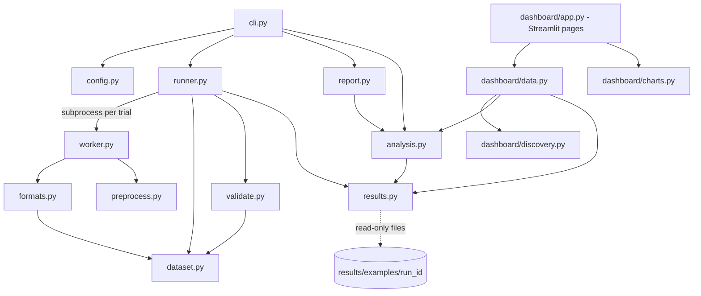
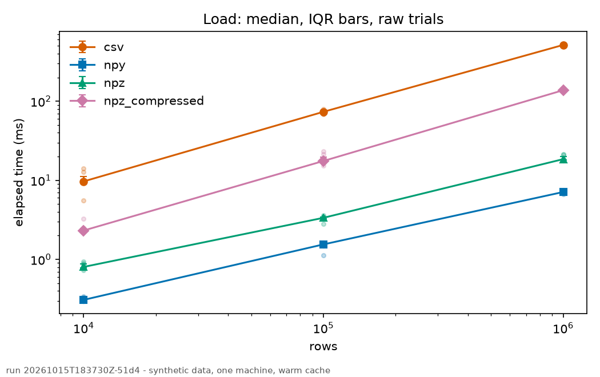
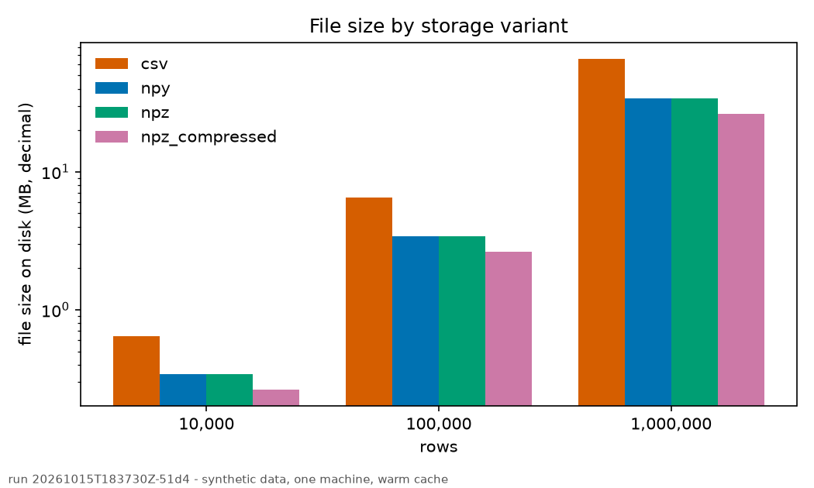

# Scientific Data Performance Lab

A small, reproducible benchmark that measures how storage format, parsing, compression and preprocessing affect the time and memory needed to turn a dataset on disk into usable NumPy arrays, plus a read-only Streamlit dashboard for exploring the recorded results.

> **Independent educational project.** It is not affiliated with, endorsed by, or an official project of CERN or CERN-HSF. The data is synthetic and HEP-inspired.

**Status:** the benchmark CLI and the dashboard are implemented and tested locally (Python 3.12 and 3.13). One real example run is committed under `results/examples/`. The GitHub Actions workflow exists but has **not** been run on GitHub, and the dashboard is **not deployed** (see [Live demo and source](#live-demo-and-source)).

## Contents

1. [Live demo and source](#live-demo-and-source)
2. [Why this project exists](#why-this-project-exists)
3. [Features](#features)
4. [Architecture](#architecture)
5. [Folder structure](#folder-structure)
6. [Technology stack](#technology-stack)
7. [Installation](#installation)
8. [Running the CLI](#running-the-cli)
9. [Launching the dashboard](#launching-the-dashboard)
10. [Benchmark methodology](#benchmark-methodology)
11. [Understanding the results](#understanding-the-results)
12. [Example results](#example-results)
13. [Testing](#testing)
14. [Deployment](#deployment)
15. [Limitations](#limitations)
16. [Reproducibility](#reproducibility)
17. [Future improvements](#future-improvements)
18. [License and project status](#license-and-project-status)
19. [References](#references)

## Live demo and source

- **Source:** <https://github.com/vishnu97770/Scientific_Data_Performance_Lab>
- **Live demo:** *not deployed yet.* The app is prepared for Streamlit Community Cloud ([docs/deployment.md](docs/deployment.md)); a URL will be added here only after the deployment has been created and checked.

Until then, run the dashboard locally ([Launching the dashboard](#launching-the-dashboard)).

## Why this project exists

Scientific pipelines read data from storage, decode or parse it, convert it to in-memory arrays and preprocess it before analysis. The cost of those steps depends on the data representation: CSV needs text parsing, `.npy` is one header plus raw bytes, `.npz` adds ZIP framing, and compressed `.npz` adds DEFLATE. The fastest or smallest choice depends on the workload and the machine, so the project measures it instead of assuming.

It is also a practice ground for sound measurement: fixed workloads, bit-exact correctness checks before any timing is accepted, repeated trials in fresh processes, raw observations kept as the source of truth, and conclusions scoped to what was measured. It deliberately does **not** claim to reproduce CERN-scale workloads or to benchmark ROOT.

## Features

- **Four storage variants** holding the same deterministic structured array: CSV, NumPy `.npy`, uncompressed `.npz` and compressed `.npz`.
- **Strict correctness gate:** every loader must reproduce the generated data bit for bit (CSV is written with `%.17g`); no timing is accepted otherwise.
- **Operations:** write, load, preprocess and load + preprocess, at 10^4, 10^5 and 10^6 rows (10^7 only with `--allow-large`).
- **Measurement design:** one fresh subprocess per trial, 2 warm-up and 7 measured rounds by default, shuffled variant order with a recorded seed, median and IQR, warm OS page cache only.
- **Memory counters:** raw `ru_maxrss`, `VmHWM` and `VmRSS`; the difference to the parent is only labelled an *estimate*.
- **Raw data first:** `trials.jsonl` and `run.json` are the source of truth; `summary.csv`, plots and the report are regenerated from them. `sdplab check-run` verifies a finished run.
- **Read-only Streamlit dashboard:** Overview, Format comparison, Detailed results, Methodology and About pages; scoped "lowest median" and "smallest file" statements; accessible colour and shape coding; safe downloads of the recorded artifacts. It cannot run benchmarks, accept uploads or read arbitrary paths.

## Architecture



The runner never imports NumPy and reaches the worker only through a subprocess. The dashboard reads recorded files only, reuses the engine's own validation (`validate_run`) and summary statistics (`summarize`), and is the only code that imports Streamlit. Details: [docs/architecture.md](docs/architecture.md); decisions: [docs/adr/](docs/adr/README.md).

## Folder structure

```text
.
├── README.md  pyproject.toml  uv.lock  .python-version
├── streamlit_app.py                  # dashboard entry point (Streamlit Community Cloud main file)
├── .streamlit/config.toml            # theme and server settings
├── .github/workflows/ci.yml          # ruff, format check, pytest on 3.12 and 3.13, floors, engine-only
├── configs/                          # example.toml (quick) and benchmark.toml (documented defaults)
├── src/sdplab/
│   ├── dataset.py  formats.py  preprocess.py  validate.py   # data model, loaders, workload, checks
│   ├── worker.py  runner.py  results.py  config.py          # execution and persistence
│   ├── analysis.py  report.py  cli.py                       # statistics, plots, command line
│   └── dashboard/                    # discovery.py  data.py  charts.py  app.py
├── tests/                            # engine, CLI, docs and dashboard tests
├── docs/                             # architecture, methodology, limitations, development, deployment, ADRs, research
├── data/generated/                   # generated datasets (git-ignored)
└── results/
    ├── examples/<run_id>/            # committed example run (tracked)
    └── raw/  plots/  reports/        # your own runs (git-ignored)
```

## Technology stack

| Technology | Role |
|---|---|
| Python >= 3.12 (3.13 primary) | Engine, CLI, dashboard |
| uv | Environments and `uv.lock` |
| NumPy >= 2.1 | Structured arrays, `.npy`/`.npz`, CSV parsing |
| Matplotlib >= 3.10.8 | Static plots (imported only by `report.py`) |
| Streamlit >= 1.66, < 2 (optional `dashboard` group) | Read-only results explorer; pandas and Altair arrive with it |
| pytest, Ruff | Tests, lint and format |
| GitHub Actions | CI (no benchmarks) |

The engine needs only NumPy and Matplotlib. pandas, PyArrow, h5py and ROOT are not used (ADR-013).

## Installation

Ubuntu or another Linux (the memory counters use `/proc`), with [uv](https://docs.astral.sh/uv/) installed:

```bash
git clone https://github.com/vishnu97770/Scientific_Data_Performance_Lab.git
cd Scientific_Data_Performance_Lab
uv sync --locked                     # engine + dev tools + dashboard, from uv.lock
uv sync --locked --no-group dashboard   # engine only (the dashboard tests then skip)
uv run sdplab --help
```

## Running the CLI

```bash
uv run sdplab info                                      # versions, machine environment
uv run sdplab prepare  --config configs/example.toml    # generate data, write the four variants, bit-exact gate
uv run sdplab validate --config configs/example.toml    # re-check existing files
uv run sdplab run      --config configs/example.toml    # prepare, gate, then the benchmark
uv run sdplab check-run --run results/raw/<run_id>      # consistency check of a finished run
uv run sdplab report   --run results/raw/<run_id>       # summary.csv, plots and report from raw files
uv run sdplab report   --run results/raw/<run_id> --example-dir results/examples   # self-contained copy
```

`configs/example.toml` is a quick local run; `configs/benchmark.toml` has the documented defaults (10^4 to 10^6 rows, 2 warm-up and 7 measured rounds) and takes a few minutes. Configuration is strict TOML; unknown keys are rejected.

**Exit codes:** `0` success · `1` internal error · `2` usage or configuration error · `3` correctness gate failed, or `check-run` found problems · `4` run completed but some trials failed, timed out or were incorrect · `5` pre-flight refused (insufficient RAM or disk, `--allow-large` missing, or an unsupported option).

## Launching the dashboard

```bash
uv run streamlit run streamlit_app.py --server.address 127.0.0.1
```

Open <http://127.0.0.1:8501>. Streamlit binds all network interfaces by default, so keep `--server.address 127.0.0.1` for local use. The app lists the runs found directly under `results/examples/` (set `SDPLAB_RESULTS_DIR` to use another results root, `SDPLAB_REPO_URL` to change the source link). Restart the server after editing modules under `src/sdplab/`.

| Page | Shows |
|---|---|
| Overview | Run identity, conditions, trial counts, key facts |
| Format comparison | Choose operation, size and formats: table, scoped findings, time / file size / throughput / memory charts |
| Detailed results | Full summary table, file sizes, trial counts and downloads |
| Methodology | The measurement rules and their limits |
| About | Reproducibility notes, independence statement, source link |

A run that fails the engine's consistency checks is shown as invalid with a short reason instead of being charted.

## Benchmark methodology

In short: a deterministic dataset is generated from a seed; each variant is written and must load back bit-exactly before anything is timed; each trial runs one operation in a fresh subprocess after unmeasured warm-up rounds; variant order is shuffled per round with a recorded seed; every trial (including failures) is appended to `trials.jsonl`; statistics are computed from raw trials afterwards. Write timing ends at file close and excludes `fsync`. All runs use a warm OS page cache; a process restart is never described as clearing it. Full rules: [docs/benchmark-methodology.md](docs/benchmark-methodology.md).

## Understanding the results

Cells read *median [Q1-Q3] ms (n = accepted/total)*. Check, in order: (1) failed or incorrect trials (there should be none), (2) noise and floor flags, (3) the recorded conditions (power, governor, load, filesystem), then (4) compare cells of the **same operation and size** only. Logical throughput (decoded array bytes per second) and file throughput (file bytes per second) answer different questions and are never combined. Memory columns marked *estimate* are not exact. Differences between variants include text parsing, ZIP framing, DEFLATE and file size, not just "format". The dashboard's "lowest median" and "smallest file" statements are always scoped to one operation, size and run, and say when interquartile ranges overlap. Caveats: [docs/limitations.md](docs/limitations.md).

## Example results

These are the recorded results of one run of `configs/benchmark.toml`. They describe this run on this machine and are **not** a ranking of formats. The text between the markers below is generated from the committed raw files, and a test fails if it differs from them.

<!-- results:start -->
Source: [`results/examples/20261015T183730Z-51d4`](results/examples/20261015T183730Z-51d4) (`run.json`, `trials.jsonl`, `summary.csv`). One run on one machine: 12th Gen Intel(R) Core(TM) i5-12450H, 12 logical cores, 14.8 GiB RAM, Linux 7.0.0-38-generic, Python 3.13.5, NumPy 2.5.4, data on ext4, CPU governor powersave, power ac, warm OS page cache, thread_env `inherit`. 2 warm-up and 7 measured rounds per cell, one fresh process per trial. Cells show the median [Q1-Q3] in ms over the measured rounds, with the number of accepted trials.

**Write (no fsync)**

| variant | 10,000 rows | 100,000 rows | 1,000,000 rows |
|---|---|---|---|
| csv | 45 [42-47.1] (n=7/7) | 293 [283-294] (n=7/7) | 2,773 [2,756-2,798] (n=7/7) |
| npy | 0.254 [0.174-0.273] (n=7/7) | 0.89 [0.833-0.93] (n=7/7) | 15.9 [11.6-16.2] (n=7/7) |
| npz | 0.577 [0.553-0.598] (n=7/7) | 3.26 [3.18-3.36] (n=7/7) | 24.7 [24.4-25.1] (n=7/7) |
| npz_compressed | 16.6 [16.5-16.7] (n=7/7) | 146 [145-151] (n=7/7) | 1,381 [1,376-1,385] (n=7/7) |

**Load**

| variant | 10,000 rows | 100,000 rows | 1,000,000 rows |
|---|---|---|---|
| csv | 9.69 [9.61-11.3] (n=7/7) | 73.5 [70.8-75.2] (n=7/7) | 515 [509-518] (n=7/7) |
| npy | 0.308 [0.299-0.329] (n=7/7) | 1.55 [1.5-1.58] (n=7/7) | 7.12 [7.04-7.24] (n=7/7) |
| npz | 0.803 [0.781-0.883] (n=7/7) | 3.36 [3.28-3.44] (n=7/7) | 18.5 [18.1-19.8] (n=7/7) |
| npz_compressed | 2.32 [2.26-2.45] (n=7/7) | 17.6 [17.1-19.7] (n=7/7) | 138 [137-139] (n=7/7) |

**Preprocess (in-memory data)**

| variant | 10,000 rows | 100,000 rows | 1,000,000 rows |
|---|---|---|---|
| in_memory | 0.244 [0.21-0.271] (n=7/7) | 1.72 [1.64-2] (n=7/7) | 20.2 [19.5-20.3] (n=7/7) |

**Load + preprocess**

| variant | 10,000 rows | 100,000 rows | 1,000,000 rows |
|---|---|---|---|
| csv | 10 [9.97-10.2] (n=7/7) | 77.1 [71.7-77.6] (n=7/7) | 540 [528-543] (n=7/7) |
| npy | 0.559 [0.553-0.561] (n=7/7) | 3.82 [3.7-3.93] (n=7/7) | 30.2 [30-30.6] (n=7/7) |
| npz | 1.05 [1.04-1.17] (n=7/7) | 5.63 [5.48-5.91] (n=7/7) | 42.5 [41.5-43.4] (n=7/7) |
| npz_compressed | 2.51 [2.47-2.7] (n=7/7) | 19.5 [19.3-20.1] (n=7/7) | 160 [159-162] (n=7/7) |

**File size on disk (MB, decimal)**

| variant | 10,000 rows | 100,000 rows | 1,000,000 rows |
|---|---|---|---|
| csv | 0.64 | 6.5 | 66 |
| npy | 0.34 | 3.4 | 34 |
| npz | 0.34 | 3.4 | 34 |
| npz_compressed | 0.265 | 2.65 | 26.5 |

<!-- results:end -->

Selected plots from the same run (the report in the example directory has all of them):





Reading the table: CSV load includes text parsing; `.npz` adds ZIP framing; the compressed archive adds DEFLATE; `.npy` is one header plus raw record bytes. The wide spread of the `npy` write at 1,000,000 rows was not investigated.

## Testing

```bash
uv run ruff check && uv run ruff format --check
uv run pytest                     # fast suite (about 40 s; some tests start real worker processes)
uv run pytest -m slow             # adds 10^6-row round trips
uv run --isolated --no-group dashboard --no-build --resolution lowest-direct pytest   # declared dependency floors
uv lock --check
```

The suite covers the dataset, all loaders (round trips, edge values, malformed input), preprocessing, validation, configuration, the runner and worker, result files, analysis and report, the CLI end to end, documentation links, the README results block, repository hygiene, and the dashboard (discovery safety, data loading, page rendering with Streamlit's `AppTest`). Tests never assert on timing values. Dashboard tests skip when Streamlit is not installed. CI (`.github/workflows/ci.yml`: engine, dependency-floor and dashboard jobs on Python 3.12 and 3.13, plus `check-run` of the example) is configured but has not yet run on GitHub; it never runs benchmarks. Details and the equivalent local commands: [docs/development.md](docs/development.md#ci). What was run and when is recorded in [docs/verification-log.md](docs/verification-log.md); developer notes are in [docs/development.md](docs/development.md).

## Deployment

The dashboard is prepared for Streamlit Community Cloud (main file `streamlit_app.py`, dependencies from `uv.lock`, config in `.streamlit/config.toml`, committed example data). It has **not** been deployed. Steps, the unverified assumption about uv dependency groups and its fallback, and post-deployment checks are in [docs/deployment.md](docs/deployment.md). Platform reference: <https://docs.streamlit.io/deploy/streamlit-community-cloud/deploy-your-app>.

## Limitations

- **Hosted CI has not been run.** The workflow file is checked by a test and its steps were run locally on Python 3.12 and 3.13.
- **One machine, one run.** The committed example is a single run on a laptop with the `powersave` governor on AC power, a warm page cache and no cold-cache mode. It is evidence for that setup only.
- **Imports are excluded from timings.** Each worker runs the operation once on an 8-row array before the timer so that lazy imports (for example `zipfile` for `.npz`) are not measured. A one-shot command-line user would still pay those once. (ADR-018; observation in `docs/research/research-notes.md` section 7.5.)
- **`process_time_ns` is process-wide CPU time across all threads.** With inherited thread settings, worker threads can spin: in an interactive probe an operation of about 8 ms showed about 95 ms of CPU time, while with `thread_env = "single"` both agreed (`docs/research/research-notes.md` section 7.4; one machine, not a benchmark). Use `elapsed_ns` for comparisons and `thread_env = "single"` when you want CPU time to be meaningful.
- **Write timing is not persistence time.** It ends at file close and excludes `fsync` (an experiment that is not implemented; `trials.fsync = true` is refused).
- **Linux only.** The memory counters use `/proc` and `getrusage`; other platforms are untested.
- **Dataset realism.** The data is synthetic and HEP-inspired, with no missing values; it says nothing about real detector data or CERN-scale workloads.
- **Not implemented:** JSON, HDF5, Parquet, ROOT, pandas loaders, column-wise `.npz`, partial/column reads, cold-cache runs, 10⁷ rows (the pre-flight accepts it only with `--allow-large`, untested here).

- **Dashboard:** it shows one recorded run from one machine and cannot rerun or compare machines.

More: [docs/limitations.md](docs/limitations.md).

## Reproducibility

1. `uv sync --locked`, then `uv run pytest` (the tests must pass before any benchmark is trusted).
2. Use an otherwise idle machine on AC power and keep `data_dir` off tmpfs.
3. `uv run sdplab run --config configs/benchmark.toml`, then `uv run sdplab check-run --run results/raw/<run_id>` and `uv run sdplab report --run results/raw/<run_id>`.
4. Compare `run.json` (environment, versions, dataset hashes) with the example run's. Different hardware or software gives different numbers; that is expected.

The same `(seed, rows, GENERATOR_VERSION)` gives byte-identical data within one NumPy version and platform; each dataset record stores the seed, rows, generator version, NumPy version, dtype and SHA-256. The config schema and the result schema are versioned separately.

## Future improvements

Only after the current scope stays reliable: further formats (JSON, HDF5, Parquet) and ROOT as separate, specified experiments; partial-column reads; cold-cache runs; an `fsync` experiment; multi-machine comparison. A C++ derivative explorer is a separate, later project.

## License and project status

**No license has been chosen yet**, so no permission to reuse the code is granted beyond what applies by default. A license will be added by the repository owner. Hosted CI has not run yet and the dashboard is not deployed.

## References

These links point to official project documentation or established project resources. They explain format capabilities and measurement APIs; they do **not** provide benchmark results for this repository.

### CERN and high-energy physics

1. [ROOT Manual — official documentation](https://root.cern.ch/manual/) — ROOT's scientific data storage, analysis, and visualization framework.
2. [ROOT files: storing and reading columnar data](https://root.cern.ch/manual/root_files/) — ROOT object storage, columnar datasets, selected-column reading, and RDataFrame examples.
3. [ROOT Primer: File I/O and Data Analysis](https://root.cern.ch/primer/) — introductory examples for ROOT analysis workflows.

### NumPy and Python

4. [NumPy `savez_compressed`](https://numpy.org/doc/stable/reference/generated/numpy.savez_compressed.html) — compressed `.npz` archives and their contents.
5. [NumPy `savez`](https://numpy.org/doc/stable/reference/generated/numpy.savez.html) — uncompressed `.npz` archives.
6. [NumPy `load`](https://numpy.org/doc/stable/reference/generated/numpy.load.html) — loading `.npy` and `.npz`; `allow_pickle=False` safety guidance.
7. [Python `time` module](https://docs.python.org/3/library/time.html) — `perf_counter()` and `perf_counter_ns()` for elapsed-time measurement.
8. [Python `csv` module](https://docs.python.org/3/library/csv.html) — standard-library CSV parsing and writing.
9. [Python `json` module](https://docs.python.org/3/library/json.html) — JSON serialization and deserialization.

### Other data formats and libraries

10. [pandas `read_csv`](https://pandas.pydata.org/docs/reference/api/pandas.read_csv.html) — CSV parser options, dtype handling, chunking, and memory mapping.
11. [h5py dataset documentation](https://docs.h5py.org/en/stable/high/dataset.html) — typed datasets, chunking, compression, slicing, and chunked I/O.
12. [Apache Parquet overview](https://parquet.apache.org/docs/overview/) — column-oriented storage and encoding/compression concepts.
13. [Apache Arrow: reading and writing Parquet](https://arrow.apache.org/docs/python/parquet.html) — PyArrow APIs, column selection, row groups, and practical access considerations.

### Additional sources used by the research notes

18. [NumPy `.npy` format specification](https://numpy.org/doc/stable/reference/generated/numpy.lib.format.html) — header, structured arrays, alignment.
19. [NumPy `loadtxt`](https://numpy.org/doc/stable/reference/generated/numpy.loadtxt.html) and [`genfromtxt`](https://numpy.org/doc/stable/reference/generated/numpy.genfromtxt.html) — structured dtype text parsing.
20. [NumPy `Generator` / `default_rng`](https://numpy.org/doc/stable/reference/random/generator.html) — reproducibility and the "no compatibility guarantee" note.
21. [Linux `getrusage(2)`](https://man7.org/linux/man-pages/man2/getrusage.2.html) and [Python `resource`](https://docs.python.org/3/library/resource.html#resource.getrusage) — `ru_maxrss` units and `RUSAGE_CHILDREN` semantics.
22. [Linux kernel `vm` sysctl: `drop_caches`](https://docs.kernel.org/admin-guide/sysctl/vm.html) — why cold-cache runs are not part of the default protocol.
23. [pyperf system and analysis guidance](https://pyperf.readthedocs.io/en/latest/system.html) — noise control and robust statistics.
24. [ROOT manual: TTree](https://root.cern/manual/trees/) — columnar branches and selective reading.

### Measurement, tests, and visualization

14. [pyperf benchmark guidance](https://pyperf.readthedocs.io/en/stable/run_benchmark.html) — repeated measurements, system noise, and reproducibility.
15. [psutil API documentation](https://psutil.io/api/) — not used in the MVP; listed as an alternative considered for memory sampling.
16. [pytest getting started](https://pytest.org/en/latest/getting-started.html) — test setup and invocation.
17. [Matplotlib documentation](https://matplotlib.org/stable/) — plotting and figure generation.

**Project integrity.** The example run and the local observations in the research notes are single-machine measurements, not general benchmark results. Report only results generated by the implemented code, with configuration, environment and command. Do not imply CERN sponsorship, access to CERN infrastructure or validation on real CERN data.
