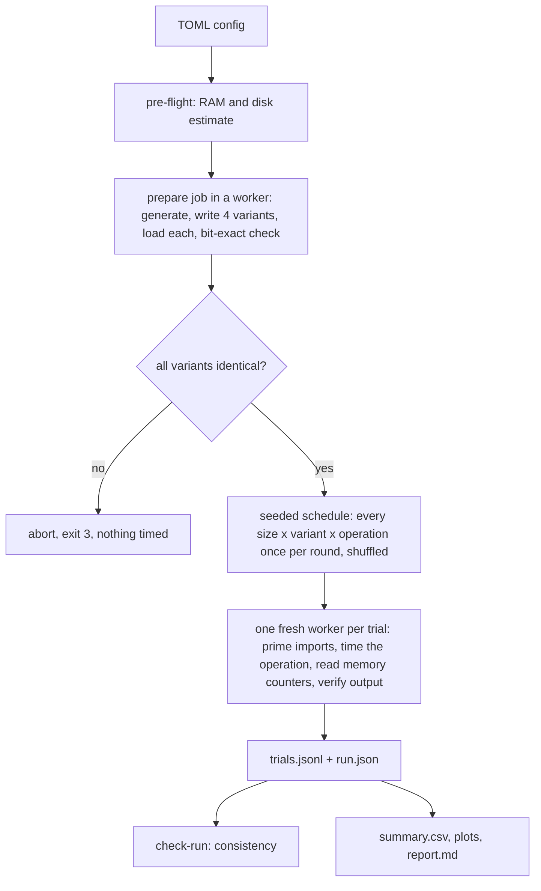

# Architecture

Scientific Data Performance Lab (`sdplab`) is a small Python package that measures how storage format affects the time, memory and space needed to get a dataset from disk into NumPy arrays. This page describes the code as it is; design rationale and the alternatives considered are in the [ADRs](adr/README.md) and [`architecture/PROPOSAL.md`](architecture/PROPOSAL.md).

## Data model

One canonical record type, little-endian and packed (34 bytes per row):

| field | dtype | meaning (synthetic, HEP-inspired) |
|---|---|---|
| `event_id` | `<i8` | 0 ... N-1 |
| `pt` | `<f8` | log-normal, strictly positive |
| `eta` | `<f8` | normal, clipped to [-2.5, 2.5] |
| `phi` | `<f8` | uniform in [-pi, pi) |
| `category_code` | `<i2` | categorical, codes 0-4, fixed weights |

The canonical in-memory form is a 1-D C-contiguous structured array of `EVENT_DTYPE`. All four storage variants hold exactly this array.

## Modules (`src/sdplab/`)

| module | responsibility | imports numpy |
|---|---|---|
| `dataset.py` | `EVENT_DTYPE`, seeded generator (`GENERATOR_VERSION`), shape-aware SHA-256 identity hash, dataset record | yes |
| `formats.py` | write/load for `csv`, `npy`, `npz`, `npz_compressed`; loaders validate the schema (`FormatError`) | yes |
| `preprocess.py` | the single shared preprocessing function and its digest | yes |
| `validate.py` | bit-exact comparisons (`Mismatch`) | yes |
| `worker.py` | one timed operation per fresh process; `prepare`/`validate` jobs; memory counters | yes |
| `runner.py` | pre-flight, prepare + gate, seeded schedule, spawning workers, timeouts, persistence | **no** |
| `results.py` | JSONL / `run.json` I/O, environment capture, `validate_run` | **no** |
| `analysis.py` | summary statistics from raw trials | no |
| `report.py` | plots and markdown (the only matplotlib importer) | no |
| `config.py` | strict TOML configuration | no |
| `cli.py` | `argparse` front end and exit codes | no |
| `dashboard/discovery.py`, `data.py` | safe run discovery (whitelisted names, size caps) and loading through `validate_run`/`summarize` | no |
| `dashboard/charts.py` | Altair charts from already-validated frames | no |
| `dashboard/app.py` | the read-only Streamlit pages (the only Streamlit importer) | no |

## Dependency rules

`cli -> {runner, analysis, report, results, config}`; `runner -> {results, config}` and reaches `worker` **only through a subprocess**; `worker -> {dataset, formats, preprocess, validate}`; `formats, validate, preprocess -> dataset`; `analysis`, `report` read only result files. Nothing imports `cli`. `dashboard` reads result files only through `results`/`analysis`, never imports `runner` or `worker`, and the engine never imports `dashboard` (optional dependency group, ADR-021). The runner process deliberately never imports numpy so that it stays small (see ADR-005). `tests/test_cli.py` checks that the run path never imports matplotlib.

## Data flow

## Results layout

`results/raw/<run_id>/{run.json, trials.jsonl, summary.csv}` (ignored by Git), `results/plots/<run_id>/`, `results/reports/<run_id>.md`, and curated copies under `results/examples/<run_id>/` (tracked). The configuration schema (`config_schema_version`) and the result schema (`results_schema_version`) are versioned separately. Run ids are unique per invocation, so a new run never overwrites an old one; `report --example-dir` refuses to overwrite an existing example. Generated data files in `data/generated/` are deterministic and are rewritten by `prepare`.
