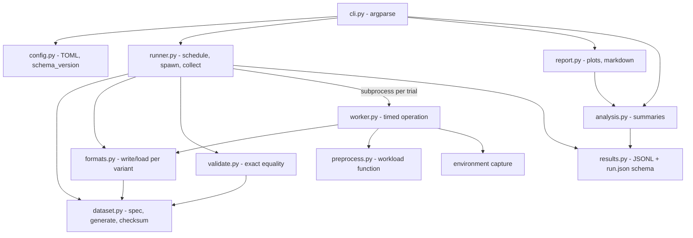
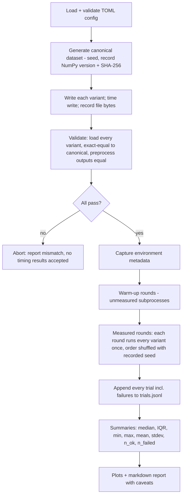

# Architecture proposal — Scientific Data Performance Lab

**Status: PROPOSED — awaiting explicit user confirmation.** Nothing below is implemented or final.
Research basis: [`docs/research/research-notes.md`](../research/research-notes.md) (IDs such as N8, M3 refer to rows there).

Independent educational project. Not affiliated with or endorsed by CERN or CERN-HSF.

## 1. Problem, users, research questions

**Problem.** Turning a dataset on disk into usable NumPy arrays involves parsing/decoding, type conversion and
copies. How much each costs depends on representation and workload, and is easy to measure unfairly.

**Users.** (1) Technical reviewers judging scientific-computing and measurement discipline (primary).
(2) Students running the tool locally to see the trade-offs.

**Research questions (MVP).**
- RQ1 How do file size and write time differ across CSV, `.npy`, uncompressed `.npz`, compressed `.npz` for the same data?
- RQ2 How does full-load time differ, and how much of it is parsing vs raw read vs decompression?
- RQ3 How much does preprocessing add once data is in memory (so load-vs-compute can be separated)?
- RQ4 What is the peak-memory cost of each loader?
- RQ5 How large is run-to-run variability on a consumer laptop, and does format ranking stay stable across sizes?

## 2. Scope

**MVP:** four variants — `csv`, `npy`, `npz`, `npz_compressed`; synthetic HEP-inspired dataset at 10⁴/10⁵/10⁶ rows;
workloads write, load, preprocess, load+preprocess; correctness validation; subprocess-per-trial runner;
raw results + environment metadata; median/IQR summaries; plots + markdown report; argparse CLI + TOML config.

**Non-goals (MVP):** JSON, HDF5, Parquet, ROOT; column projection/streaming/mmap; cold-cache runs; missing values;
real experiment data; parallel/distributed loading; statistical significance testing; GUI.

**Optional / gated:** 10⁷-row stress size (only after a pre-flight RAM/disk estimate passes);
`csv_pandas` variant behind an optional extra; `--fsync` write timing.

**Future (explicitly not planned work):** HDF5 (chunks/compression), Parquet (row groups, projection), ROOT/uproot, cold-cache protocol.

## 3. Requirements (summary; IDs assigned during GSD planning)

Functional: deterministic dataset generation; four write paths; four loaders producing the same canonical table;
exact-equality validation; documented preprocessing; isolated timed trials with warm-up and randomised order;
raw trial storage incl. failures; environment capture; summaries; plots; CLI; versioned config and result schema.
Non-functional: Python ≥ 3.11; Linux-first; reproducible with `uv`; every result traceable to config + dataset checksum;
small dependency set; tests runnable in CI in seconds (tiny datasets); no benchmark claims in repo until produced by the tool.

## 4. Component diagram



## 5. End-to-end workflow



## 6. Repository structure and module responsibilities

```
src/sdplab/
  config.py      load/validate TOML; schema_version; defaults
  dataset.py     DatasetSpec, generate(), canonical table, content checksum
  formats.py     the 4 variants: write(path, table) / load(path) -> table; small registry dict
  preprocess.py  the single documented workload function
  validate.py    exact-equality checks, dtype/shape/column-order checks
  worker.py      `python -m sdplab.worker`: one timed operation, prints one JSON line
  runner.py      pre-flight, schedule, spawn workers, collect, persist
  results.py     trial/run record dataclasses, JSONL + run.json read/write, schema_version
  analysis.py    summary statistics from trials
  report.py      matplotlib plots + markdown tables (only module importing matplotlib)
  cli.py         argparse subcommands: info, prepare, validate, run, report
tests/           pytest (tiny N); unit + one end-to-end smoke
docs/            research, architecture, ADRs
```

Deliberately **not** separate modules: timing and memory measurement (live in `worker.py`, ~40 lines, only
caller); environment capture (a function in `results.py`/`worker.py` unless it grows); no abstract base classes —
`formats.py` is a deep module behind a two-function interface per variant, extended by adding a registry entry.

**Dependency rules.** `cli → {runner, analysis, report, config}`; `runner → {dataset, formats, validate, results, config}` and
reaches `worker` only through `subprocess`; `worker → {formats, preprocess, dataset}`; `analysis, report → results`;
`formats, validate → dataset`. Nothing imports `cli`; only `report` imports matplotlib; only `config` reads TOML;
`dataset` imports nothing from the package.

## 7. Dataset (proposed schema)

| Column | dtype | Distribution (documented, seeded) |
|---|---|---|
| `event_id` | int64 | 0…N−1 |
| `pt` | float64 | log-normal, strictly positive (GeV-like) |
| `eta` | float64 | normal clipped to [−2.5, 2.5] |
| `phi` | float64 | uniform [−π, π) |
| `category_code` | int16 | categorical, 4–6 codes with fixed weights |

Canonical in-memory form: `dict[str, np.ndarray]` of contiguous 1-D columns, fixed column order.
Logical payload = 34 bytes/row → 34 MB at 10⁶ rows, ~340 MB at 10⁷ (CSV text ≈ 2–3× larger, to be measured).
`float64` chosen so `%.17g` text round-trips exactly (see risk R1); `float32` columns are a deferred variant.
Seeding uses `np.random.default_rng(seed)`; because `Generator` streams are not version-stable (N8), each run stores
the NumPy version and a SHA-256 over the canonical column bytes.

**Per-variant layout (documented difference, a real part of what is measured):**
- `csv` — header row + one row per event; floats written `%.17g`; loaded with `np.loadtxt` into a structured array, then split into contiguous columns (conversion is part of load).
- `npy` — **one structured (record) array**, row-wise in memory; load = `np.load` then field extraction into contiguous columns.
- `npz` / `npz_compressed` — one array per column (`savez` / `savez_compressed`); load = read all members and close archive.

## 8. Preprocessing workload (single, deterministic)

On the canonical table: `mask = (pt > 20.0) & (abs(eta) < 2.4)`; output = `n_selected`, `sum(pt[mask])`, and the z-scored
`pt` column (using full-column mean/std). Parameters live in config. Identical inputs ⇒ outputs must be exactly equal
across variants; this is checked in validation.

## 9. Measurement protocol

| Aspect | Decision |
|---|---|
| Timing | `time.perf_counter_ns()` differences only (T1), measured **inside the worker** so interpreter start-up and imports are excluded. `process_time_ns` recorded alongside. |
| Boundaries | `write`: canonical table → file (default: through `close()`, no fsync; `--fsync` adds it and is labelled). `load`: open file → canonical contiguous columns in memory. `preprocess`: canonical table → outputs (table already in memory). `load_preprocess`: both, one timer. |
| Excluded from timers | generation, validation, plotting, file listing, JSON output. |
| Isolation | One fresh subprocess per trial; the worker reports its own `RUSAGE_SELF` peak (M3). |
| Warm-up | `warmup_rounds` (default 2) unmeasured subprocess rounds. |
| Repeats | `measured_rounds` (default 7), all kept. |
| Order | Each round runs every variant once, order shuffled by recorded seed (block randomisation). |
| Cache | **Ordinary/warm-cache** benchmark. Process restarts do not clear the page cache (C2). Cold-cache runs are deferred (C1: system-wide, not recommended outside testing). |
| Memory | `peak_rss_kib` (`ru_maxrss`, Linux KiB) and `rss_baseline_kib` after imports; derived `peak_minus_baseline_kib`. Process high-water mark, Linux-only, includes interpreter. |
| Throughput | `logical_throughput = logical_bytes / elapsed` (comparable across formats); `file_throughput = file_bytes / elapsed` (disk-side view). Reported separately, never mixed. |
| Environment | Python/NumPy/matplotlib versions, OS/kernel, CPU model, core count, RAM, filesystem type and data dir, CPU governor, 1-min load average before/after, power source if readable, git commit, config hash, dataset checksum. |
| Noise | Raw trials kept; failures recorded not dropped; no automatic outlier removal; report flags trials with high load or whose max ≥ k×median (flag only). Docs advise AC power, idle machine, performance governor (pyperf notes, T5) but the tool does not change system settings. |
| Statistics | Per (variant, size, operation): n_ok, n_failed, median (headline), IQR, min, max, mean, stdev. Ratios between variants use medians. No significance claims. |
| Correctness gate | Validation precedes any accepted timing; mismatch aborts the run. |
| Caveats | Synthetic data; one machine; warm cache; Python/NumPy-specific; not CERN-scale. |

## 10. Configuration and result schema (versioned)

```toml
schema_version = 1
[dataset]  seed = 12345  sizes = [10000, 100000, 1000000]  data_dir = "data"
[formats]  enabled = ["csv", "npy", "npz", "npz_compressed"]
[workload] pt_cut = 20.0  eta_cut = 2.4  operations = ["write", "load", "preprocess", "load_preprocess"]
[trials]   warmup_rounds = 2  measured_rounds = 7  order_seed = 777  fsync = false
[output]   results_dir = "results"
```

Results per run: `results/<run_id>/run.json` (schema_version, config, environment, dataset checksums, file sizes),
`trials.jsonl` (one raw trial per line: variant, size, operation, round, status, elapsed_ns, process_time_ns,
peak_rss_kib, rss_baseline_kib, logical_bytes, file_bytes, error), `summary.csv`, `report.md`, `plots/*.png`.
Raw as JSONL because it is append-safe and keeps failure records with free-form errors; `summary.csv` is the flat export.
Loaders reject unknown `schema_version`.

## 11. Errors and validation

- Config: unknown keys, bad types, sizes ≤ 0, unknown formats → fail fast with a message naming the key.
- Pre-flight: estimate disk and RAM per size (`logical_bytes × factor`); refuse sizes above available resources; 10⁷ requires `--allow-large`.
- Validation: same column names/order, dtypes, length; **bit-exact** array equality (`np.array_equal` + dtype check); preprocess outputs equal.
- Worker failure (non-zero exit, exception, timeout): trial recorded with `status="failed"` and message; run continues; summary reports n_failed.
- Never `allow_pickle=True`.

## 12. Tests, CI, acceptance

- **Unit:** generator determinism and distributions bounds; per-variant write→load round-trip; validator catches injected mismatch; preprocess known-answer; config rejects bad input; stats on fixed vectors; results schema round-trip.
- **Integration:** `prepare → validate → run → report` end-to-end with 1 000 rows, 1 warm-up, 2 trials, <30 s.
- **Not tested for speed:** no assertions on timings (flaky); only on structure and validity.
- **CI:** GitHub Actions on Ubuntu: `uv sync`, `ruff check`, `ruff format --check`, `pytest`. Benchmarks are not run in CI.
- **MVP acceptance (observable):** fresh clone + `uv sync` → documented commands produce a report for 10⁴–10⁶ rows; all validation passes; README results (if included) come from an included run directory with its `run.json`; CI green.

## 13. Dependencies

Runtime: `numpy>=2.0`, `matplotlib`. Dev: `pytest`, `ruff`. Stdlib: `argparse`, `tomllib`, `resource`, `subprocess`, `json`, `statistics`, `platform`.
Optional extra (deferred): `pandas` for `csv_pandas`. Not used: `psutil` (stdlib `resource` suffices for peak RSS), `pyperf`, `typer`, `h5py`, `pyarrow`.

## 14. Risks and deferred decisions

| ID | Risk / decision | Mitigation |
|---|---|---|
| R1 | CSV float round-trip may not be exactly equal (gap 4) | Test first in the correctness phase; `%.17g`; fallback = documented ULP tolerance **for CSV only**, recorded as an ADR amendment. |
| R2 | `loadtxt` very slow or memory-hungry at 10⁶–10⁷ rows | Pre-flight limits; report as a result; optional pandas variant later. |
| R3 | Warm-cache results hide I/O differences | Stated explicitly; cold-cache deferred. |
| R4 | Laptop thermal/power noise | Record governor/load/power; round-robin ordering; median+IQR; advise AC power. |
| R5 | Structured `.npy` vs per-column `.npz` conflates format and layout | Documented as variant definition; per-column `.npy` directory deferred as a possible 5th variant. |
| R6 | Disk is 87 % full (29 GB free) | Pre-flight check; data dir configurable and gitignored. |
| D1 | Calendar schedule | Deferred — to be confirmed by the user. |
| D2 | `csv_pandas`, float32 columns, `--fsync` default, cold-cache protocol | Deferred. |

## 15. Architecture decision records (summary; full files created after approval)

| ADR | Decision | Alternatives | Rationale | Trade-off |
|---|---|---|---|---|
| 001 | One installable package `sdplab` with ~10 flat modules | many sub-packages / ABC plugin system | One developer, 4 variants; interface depth > count of modules | Adding a format later edits `formats.py` (or splits it then) |
| 002 | Canonical in-memory form = dict of contiguous 1-D columns | pandas DataFrame; structured array | No heavy dep; unambiguous equality; columnar matches analysis | Loaders pay a documented conversion |
| 003 | Variants: csv, npy (structured), npz, npz_compressed | per-column npy; JSON/HDF5/Parquet first | Smallest set answering RQ1–RQ5; others deferred until baseline correct | `.npy` row-wise vs `.npz` columnar layout differ (R5) |
| 004 | One fresh subprocess per trial, timing inside worker | in-process loop; pyperf | Clean RSS high-water per trial; no state leakage; start-up excluded | More code than a loop; ~100 ms/trial overhead outside timers |
| 005 | `resource.ru_maxrss` for memory | psutil sampling; tracemalloc | Exact peak, stdlib, per process (M1–M3) | Linux-only units; includes interpreter baseline |
| 006 | Warm-cache is the only supported cache mode | drop_caches; O_DIRECT; fadvise | Portable, unprivileged, honest (C1/C2) | Not a disk-throughput benchmark |
| 007 | Exact equality validation; tolerance only by explicit ADR | `allclose` everywhere | Catches silent corruption; strict is a feature | CSV may need amendment (R1) |
| 008 | Raw results JSONL + run.json; summary CSV derived | CSV only; SQLite | Append-safe, keeps failures, versioned | Flatten step for spreadsheets |
| 009 | argparse + TOML (`tomllib`) | Typer/Click; YAML | No dependencies; 5 subcommands is small | Less pretty help |
| 010 | Median/IQR headline; no significance tests | mean±std; t-tests/bootstrap | Robust on noisy laptops (T3/T4); avoids invented rigor | Less statistical power; bootstrap CI deferred |
| 011 | Data files and results are gitignored; one small example run may be committed | commit all outputs | Repo stays small; reproducibility via config + checksum | Reviewers must run the tool or read the example |

## 16. Proposed phases and effort (relative, no calendar)

Critical path: 1 → 2 → 3 → 4 (5 can overlap docs work).

| Phase | Objective | Size |
|---|---|---|
| 1 Foundation & dataset | uv project, ruff/pytest/CI, config, dataset generator, checksum, preprocess, validator | M |
| 2 Format variants | four write/load paths, exact round-trip tests, resolve R1 | M |
| 3 Measurement & runner | worker, environment capture, schedule/order, pre-flight, results schema | L |
| 4 Analysis, reports, CLI | summaries, plots, markdown report, polished CLI, end-to-end test | M |
| 5 Release hardening | example run, README results section from real data, troubleshooting, docs/CI verification | S |

Sizes are relative effort estimates only; the schedule needs your confirmation.
