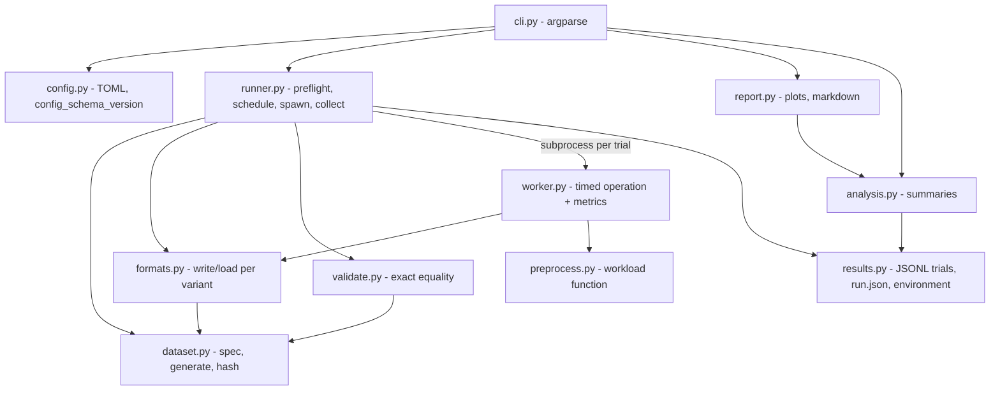
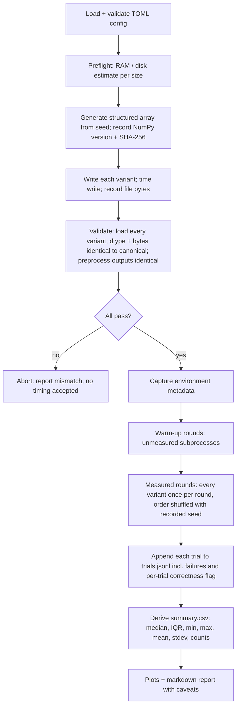

# Architecture proposal — Scientific Data Performance Lab

**Status: confirmed design baseline (revision 3, 2026-10-13). Phases 1-4 are implemented and verified locally (see `docs/verification-log.md`); this document is the design rationale, and where the code differs, `docs/adr/ADR-018.md` and `ADR-019.md` record why (import priming; `preprocess` runs once per size; Phase 3 design points).**
Research basis: [`docs/research/research-notes.md`](../research/research-notes.md) (IDs such as N8, M3 refer to rows there).
Revision 2 (approved as planning baseline 2026-10-13, with clarifications: memory difference = estimate; CSV failures investigated and documented before any policy change) applies the user decisions of 2026-10-13: shared structured-array layout, strict CSV round-trip, no pandas in MVP,
JSONL trials, relative effort only, narrow git ignores.

**Revision 3 (user decisions, 2026-10-13):** ADR-005 amended (VmHWM/VmRSS/parent launch peak, verified experimentally); separate config/results schema counters (ADR-014); Python ≥ 3.12 with CI on 3.12 and 3.13 (ADR-015); `timeout_s`, noise thresholds and thread-env control in the initial config schema, documented exit codes and an example config (ADR-016); correctness validated for every operation (ADR-017). Worker input design and loop order are **deferred to Phase 3 planning**.

Independent educational project. Not affiliated with or endorsed by CERN or CERN-HSF.

## 1. Problem, users, research questions

**Problem.** Turning a dataset on disk into usable NumPy arrays involves parsing/decoding, type conversion and copies.
Their cost depends on representation and workload, and is easy to measure unfairly.

**Users.** (1) Technical reviewers judging scientific-computing and measurement discipline (primary).
(2) Students running the tool locally to see the trade-offs.

**Research questions (MVP).**
- RQ1 How do file size and write time differ across CSV, `.npy`, uncompressed `.npz` and compressed `.npz` for the *same* logical records?
- RQ2 How does full-load time differ, and how much is text parsing vs raw read vs archive overhead vs decompression?
- RQ3 How much does preprocessing add once data is in memory (separating load from compute)?
- RQ4 What is the peak-memory cost of each loader?
- RQ5 How large is run-to-run variability on a consumer laptop, and does the ordering stay stable across sizes?

## 2. Scope: minimum useful MVP vs optional extensions

**Minimum useful MVP (the thing that must work):**
four variants (`csv`, `npy`, `npz`, `npz_compressed`) holding one identical structured array;
synthetic HEP-inspired dataset at 10⁴/10⁵/10⁶ rows; operations write / load / preprocess / load+preprocess;
exact-equality validation gate; subprocess-per-trial runner with warm-ups and shuffled order;
JSONL raw trials + `run.json` metadata; median/IQR `summary.csv`; at least a load-time and a file-size plot and a markdown report;
argparse CLI + TOML config; pytest suite + GitHub Actions CI; README with honest results from a real local run.

**Optional extensions (each independent, none required for MVP completion):**
10⁷-row stress size behind `--allow-large` and a pre-flight check · `--fsync` write experiment · peak-memory and throughput plots beyond the minimum ·
`csv_pandas` loader · column-wise `.npz` as a *distinct storage-layout study* · float32 schema variant ·
per-column projection · JSON / HDF5 / Parquet / ROOT variants · cold-cache protocol.

**Non-goals (MVP):** missing values, real experiment data, mmap/streaming/partial reads, parallel or distributed loading,
statistical significance testing, GUI, claims about ROOT or CERN-scale behaviour.

## 3. Requirements (summary; the testable list is `docs/requirements.md`)

Functional: deterministic dataset generation with checksum; four write paths from one structured array; four loaders returning
a structured array of the identical dtype; exact validation; documented preprocessing; isolated timed trials with warm-up and
randomised order; JSONL raw trial storage incl. failures; environment capture; summaries regenerable from raw files; plots; CLI;
versioned config and result schema.
Non-functional: Python ≥ 3.12 (primary 3.13; CI tests 3.12 and 3.13); Linux-first; reproducible with `uv`; every result traceable to config + dataset hash + versions;
small dependency set; tests run in seconds with tiny datasets; no benchmark numbers in the repo unless produced by the tool.

## 4. Component diagram



## 5. End-to-end workflow



## 6. Repository structure and module responsibilities

```
pyproject.toml  uv.lock  .gitignore  README.md
src/sdplab/
  config.py      load/validate TOML (types, ranges, unknown keys); config_schema_version; defaults
  dataset.py     EVENT_DTYPE, DatasetSpec, generate() -> structured array, array_sha256()
  formats.py     4 variants: write(path, array) / load(path) -> array; small registry dict
  preprocess.py  the single documented workload function
  validate.py    exact-equality checks (dtype, shape, bytes/hash, preprocess outputs)
  worker.py      `python -m sdplab.worker`: one timed operation, one JSON line on stdout
  runner.py      preflight, scheduling, spawning workers, collecting, persisting
  results.py     trial/run record dataclasses, JSONL + run.json I/O, environment capture, results_schema_version
  analysis.py    summary statistics from trials (no benchmark rerun needed)
  report.py      matplotlib plots + markdown tables (only module importing matplotlib)
  cli.py         argparse subcommands: info, prepare, validate, run, report
tests/           pytest, tiny N; unit + one end-to-end smoke
data/generated/  (gitignored)      results/raw|plots|reports/ (gitignored)      results/examples/ (tracked, curated)
docs/            research, architecture, ADRs
```

Deliberately **not** separate modules: timing/memory measurement (inside `worker.py`; its only caller) and environment capture
(inside `results.py`). No abstract base classes: `formats.py` is a deep module with a two-function interface per variant and a registry.

**Dependency rules.** `cli → {runner, analysis, report, config}`; `runner → {dataset, formats, validate, results, config}`, reaching
`worker` only through `subprocess`; `worker → {formats, preprocess, dataset}`; `analysis, report → results`; `formats, validate → dataset`;
`dataset` imports nothing from the package. Nothing imports `cli`. Only `report` imports matplotlib; only `config` reads TOML.

## 7. Dataset and storage layout

One logical record type, little-endian, packed (no alignment padding):

```python
EVENT_DTYPE = np.dtype(
    [("event_id", "<i8"), ("pt", "<f8"), ("eta", "<f8"), ("phi", "<f8"), ("category_code", "<i2")]
)  # 34 B/row
```

| Field | Distribution (documented, seeded) |
|---|---|
| `event_id` | 0…N−1 |
| `pt` | log-normal, strictly positive (GeV-like) |
| `eta` | normal clipped to [−2.5, 2.5] |
| `phi` | uniform [−π, π) |
| `category_code` | categorical, 4–6 codes, fixed weights |

Canonical in-memory form = a 1-D C-contiguous structured array of `EVENT_DTYPE`. **All four variants store and return this same array.**

| Variant | Storage | Write | Load |
|---|---|---|---|
| `csv` | header + one row/event; ints `%d`; float64 `%.17g`; `\n`, `,` | explicit formatter over fields | `np.loadtxt(..., dtype=EVENT_DTYPE, delimiter=",", skiprows=1)` — explicit dtype, no inference |
| `npy` | `.npy`, the structured array | `np.save` | `np.load(allow_pickle=False)` |
| `npz` | zip (stored), single member `events` = the structured array | `np.savez` | `np.load` → read member → close archive |
| `npz_compressed` | zip DEFLATE, member `events` | `np.savez_compressed` | same as `npz` |

Unavoidable differences (documented in README): CSV is text and needs per-field parsing; `.npy` has a header and raw record bytes;
`.npz` adds zip framing and a member copy (compressed adds DEFLATE); loaders differ in how many copies they make. These are part of what is measured.
Logical payload = `N × 34` bytes (34 MB at 10⁶ rows). `float64` is used so `%.17g` can round-trip; `float32` is an optional later schema.
The column-wise `.npz` is **not** in the MVP; if added later it is reported as a storage-layout study, not as a format-only comparison.

**Reproducibility.** `np.random.default_rng(seed)` is deterministic for a given NumPy version but has no cross-version stream guarantee (N8).
Every run stores seed, NumPy version, dtype string and `dataset_sha256` (SHA-256 of the array's bytes). `validate` regenerates and compares;
a hash mismatch against a recorded run is reported as "dataset differs", not silently accepted.

## 8. Preprocessing workload

Single deterministic function on the in-memory array: `mask = (pt > pt_cut) & (abs(eta) < eta_cut)`; outputs `n_selected`, `sum(pt[mask])`,
and the z-scored `pt` column. Parameters are in config. Because loaded arrays are bit-identical, outputs must be identical across variants and
are checked in validation.

## 9. Measurement protocol

| Aspect | Decision |
|---|---|
| Timing | `time.perf_counter_ns()` differences only (T1), taken **inside the worker** around the operation. `process_time_ns` also recorded. |
| Process start-up | Excluded from the headline metric by timing inside the worker. The parent separately records `subprocess_wall_ns` (spawn → exit) and `startup_overhead_ns = subprocess_wall_ns − (operation + validation + output time)` is **reported but never mixed into** operation timings. |
| Operations | `write` (array → file, through `close()`, **no fsync** by default; may include OS buffering and is not the time to persist to the device) · `load` (file → structured array in memory) · `preprocess` (array in memory → outputs; only meaningful on in-memory data) · `load_preprocess` (one timer around both). |
| Experimental `--fsync` | Separate, explicitly labelled experiment (`write_fsync`); never merged with default write results. Optional extension. |
| Excluded from timers | generation, validation hashing, JSON output, plotting. |
| Per-trial correctness (every operation, where applicable) | After the timer stops **and after memory counters are read**, the worker verifies the output of whatever it just did and records `correct` plus `correctness_check`: `load` → hash of the loaded array vs expected `dataset_sha256`; `preprocess` → digest of its outputs vs the expected digest; `load_preprocess` → both; `write` → the written scratch file is read back by an untimed reference loader and its hash compared. A check that cannot apply is recorded as `not_applicable`, never silently `true`. Pre-run validation (all variants) must still pass before any trial is scheduled. How the worker obtains the expected values and its `write`/`preprocess` input is decided in Phase 3 planning. |
| Isolation | One fresh subprocess per measured and warm-up trial. The worker reports its own `RUSAGE_SELF` peak (M3). Parent never reads child peak via `RUSAGE_CHILDREN`. |
| Warm-up | `warmup_rounds` (default 2) unmeasured subprocess rounds; recorded as config, not as results. |
| Repeats | `measured_rounds` (default 7); all kept. |
| Order | Each round runs every (variant, operation) cell once, order shuffled by `order_seed`; seed and realised order stored. |
| Cache | **Ordinary warm-cache benchmark.** A process restart does not clear the OS page cache (C2). Files were just written/read, so the page cache is expected to hold them; this is not verified by the tool. Cold-cache runs are an optional future extension (C1). |
| Memory (ADR-005, amended) | Stored as **separate raw fields**: worker `ru_maxrss_kib` (`RUSAGE_SELF`, KiB on Linux), worker `vm_hwm_kib` and `vm_rss_baseline_kib` (`/proc/self/status` `VmHWM` / `VmRSS`; baseline sampled after imports, before the operation), and `parent_ru_maxrss_kib_at_launch` (the runner's own `ru_maxrss` immediately before spawning). **Inheritance effect (observed on this machine, see research-notes §7):** a child's `ru_maxrss` can be floored by the parent's peak at launch, while the child's `VmHWM` is independent. So `ru_maxrss` is kept raw for cross-checking and flagged (`maxrss_floor_suspect`) when it does not exceed the parent's launch value; `vm_hwm_kib` is the primary reported high-water mark. Any `vm_hwm_kib − vm_rss_baseline_kib` figure is an **estimate** (`estimated_workload_rss_kib`), never exact workload memory: both are process-wide, the baseline is a point sample, and allocator/page-cache behaviour is not modelled. Linux-only; units KiB; the runner stays small (no held arrays, `report` lazily imported). |
| Throughput | `logical_throughput_bytes_per_s = (N × 34) / elapsed_s` — same numerator for all variants. `file_throughput_bytes_per_s = file_bytes / elapsed_s` — on-disk size, differs per variant. Reported in separate columns/plots; never combined. |
| Environment | Python/NumPy/matplotlib versions, OS/kernel, CPU model, core count, RAM, filesystem type and data-dir path, CPU governor, load average before/after, power source if readable, thread-related environment variables (`OMP_NUM_THREADS`, `OPENBLAS_NUM_THREADS`, `MKL_NUM_THREADS`, `NUMEXPR_NUM_THREADS`; effective values recorded per run), git commit + dirty flag, config hash, seed, `dataset_sha256`. |
| Noise | Raw trials kept; failures recorded; **no observation is ever discarded or silently excluded**. Trials are *flagged* (flags stored in the trial record and summary, results still counted unless the trial is `failed` or `correct=false`) when 1-min load average per core exceeds `noise.max_load_per_core` before or after the trial, or when a value is ≥ `noise.outlier_factor` × the cell median. Thresholds are explicit config values with documented defaults (proposed: `outlier_factor = 3.0`, `max_load_per_core = 0.5`). Docs recommend AC power and an idle machine (T5); the tool does not change system settings except the optional worker thread-env control. |
| Statistics | Per (variant, size, operation): `n_ok`, `n_failed`, `n_incorrect`, median (headline), Q1, Q3, IQR, min, max, mean, stdev. Cross-variant ratios use medians. No significance claims. |
| Gate | A trial with `correct: false` or a failed pre-run validation never appears in accepted summaries; it is counted and reported. |
| Caveats (always in report) | Synthetic data; one machine; warm cache; CPython+NumPy specific; not CERN-scale; laptop power/thermal effects. |

## 10. Configuration and result schema (versioned)

```toml
config_schema_version = 1
[dataset]  seed = 12345  sizes = [10000, 100000, 1000000]  data_dir = "data/generated"
[formats]  enabled = ["csv", "npy", "npz", "npz_compressed"]
[workload] pt_cut = 20.0  eta_cut = 2.4  operations = ["write", "load", "preprocess", "load_preprocess"]
[trials]   warmup_rounds = 2  measured_rounds = 7  order_seed = 777  fsync = false  timeout_s = 600
[noise]    outlier_factor = 3.0  max_load_per_core = 0.5
[environment] thread_env = "inherit"   # or "single": worker env sets the four *_NUM_THREADS variables to 1; effective values always recorded
[output]   results_dir = "results"
```

Run layout: `results/raw/<run_id>/{run.json, trials.jsonl, summary.csv}`; plots → `results/plots/<run_id>/`; reports → `results/reports/<run_id>.md`;
curated examples copied to `results/examples/<run_id>/` (tracked). `summary.csv` and plots are **regenerable from `trials.jsonl` + `run.json` alone** (`sdplab report --run <dir>`), without rerunning anything.

Each line of `trials.jsonl` is a self-contained JSON object (independently parseable):

```json
{"results_schema_version":1,"run_id":"…","variant":"npz_compressed","operation":"load",
 "dataset":{"rows":1000000,"seed":12345,"dtype":"…","sha256":"…"},
 "round":3,"position":2,"phase":"measured","status":"ok","correct":true,
 "timing":{"elapsed_ns":0,"process_time_ns":0,"subprocess_wall_ns":0},
 "resources":{"ru_maxrss_kib":0,"vm_hwm_kib":0,"vm_rss_baseline_kib":0,"parent_ru_maxrss_kib_at_launch":0},
 "flags":{"noisy_load":false,"outlier_vs_median":false,"maxrss_floor_suspect":false},
 "correctness_check":"hash_of_loaded_array",
 "sizes":{"logical_bytes":0,"file_bytes":0},
 "measurement":{"warmup_rounds":2,"measured_rounds":7,"fsync":false,"cache_mode":"warm"},
 "error":null}
```
(values above are placeholders showing field names, not results). `run.json` holds environment, config, per-size dataset hashes and file sizes. The config and the result records carry **separate, independently incremented** counters (`config_schema_version`, `results_schema_version`); readers reject an unknown value of their own counter. Config validation checks types, ranges (e.g. `timeout_s > 0`, `outlier_factor > 1`, `max_load_per_core ≥ 0`, sizes > 0), enum values (`thread_env`) and unknown keys at every level.

## 11. Errors and validation

**Documented exit codes (proposed; finalised in the Phase 4 plan and listed in `--help` and the README):** `0` success · `1` unexpected internal error · `2` usage or configuration error · `3` correctness gate failed (nothing timed is accepted) · `4` run completed but some trials failed, timed out or were incorrect (all raw observations still written) · `5` pre-flight refused (insufficient RAM/disk, or `--allow-large` missing).

**Example configuration:** a small working `configs/example.toml` (quick local run, e.g. sizes 10⁴ and 10⁵, 1 warm-up, 3 measured rounds) ships with the project — configuration only, no extra code path.

- Config: unknown keys, wrong types, sizes ≤ 0, unknown formats → fail fast naming the key.
- Preflight: estimate disk and RAM per size; refuse sizes that don't fit; 10⁷ requires `--allow-large`.
- **Correctness contract (strict, unchanged without a recorded ADR):** identical dtype, shape and bytes (`sha256` + `np.array_equal`) for every loaded array; identical preprocess outputs.
  If a variant fails: investigate writer, parser and dtype first. The contract is **not** relaxed automatically; any CSV-specific tolerance would need its own ADR with justification.
- Worker crash/timeout/exception → trial `status="failed"` with message; run continues; summaries report counts.
- `allow_pickle` is never enabled.

## 12. Tests, CI, acceptance

- **Unit:** generator determinism and bounds; write→load exact round-trip for each variant (the CSV `%.17g` contract is tested first and on edge values: subnormals, ±0.0, extreme exponents, values near ties); validator rejects injected 1-ULP change; preprocess known-answer; config rejection cases; statistics on fixed vectors; JSONL/run.json round-trip and version rejection; summary regeneration from stored trials.
- **Integration:** `prepare → validate → run → report` with 1 000 rows, 1 warm-up, 2 trials, < 30 s.
- **Never assert on timings** (flaky); assert structure, validity and counts.
- **CI:** GitHub Actions on Ubuntu: `uv sync`, `ruff check`, `ruff format --check`, `pytest`. Benchmarks are not run in CI.
- **MVP acceptance (observable):** fresh clone + `uv sync` → documented commands produce a report for 10⁴–10⁶ rows; all validation passes; every README number comes from a committed example run (`run.json` + `trials.jsonl`); CI green.

## 13. Dependencies

Runtime: `numpy>=2.1`, `matplotlib>=3.10.8` (floors raised in Phase 1 after verification: `numpy 2.0` and `matplotlib 3.9` have no Python 3.13 wheels, and matplotlib below 3.10.8 fails to import under warnings-as-errors; checked with `uv run --isolated --no-build --resolution lowest-direct pytest` on 3.12 and 3.13). Dev: `pytest`, `ruff`. Stdlib: `argparse`, `tomllib`, `resource`, `subprocess`, `json`, `hashlib`, `statistics`, `platform`.
Not in MVP: `pandas` (deferred separate-loader study), `psutil`, `pyperf`, `typer`, `h5py`, `pyarrow`.

## 14. Risks and deferred decisions

| ID | Risk / decision | Mitigation |
|---|---|---|
| R1 | CSV text float round-trip may not be exact (gap 4) | `%.17g` + explicit dtypes; edge-case tests first; on failure investigate writer → parser → schema; correctness contract only changes via ADR. |
| R2 | `np.loadtxt` slow or memory-hungry at 10⁶ rows | Preflight; report as a finding. |
| R3 | Warm-cache hides device I/O | Stated explicitly; cold-cache optional later. |
| R4 | Laptop thermal/power noise | Record governor/load/power; shuffled order; median+IQR; advise AC power. |
| R5 | Structured array loses column-wise advantages | Accepted; column-wise `.npz` is a later, separately labelled study. |
| R6 | Disk 87 % full (≈29 GB free) | Preflight; configurable data dir; gitignored. |
| R7 | Pinned seed ≠ identical data on a newer NumPy | Store NumPy version + dataset hash; `validate` detects drift. |
| R8 | Per-trial hashing could perturb peak RSS | Read `ru_maxrss` before hashing; hash via buffer without copying. |
| D1 | Calendar schedule | Deferred; relative effort only. |
| D2 | `csv_pandas`, float32, `--fsync`, cold-cache, 10⁷ rows | Optional extensions. |

## 15. Architecture decision records (summary; formal files after approval)

| ADR | Decision | Alternatives | Rationale | Trade-off |
|---|---|---|---|---|
| 001 | One package `sdplab`, ~10 flat modules | sub-packages / ABC plugins | One developer, four variants | Splitting `formats.py` later if it grows |
| 002 | Canonical form = structured array (`EVENT_DTYPE`) shared by all variants | dict of columns; DataFrame | Equal logical schema and layout; format-only comparison | Row-wise layout; no columnar benefits |
| 003 | MVP variants csv / npy / npz / npz_compressed; column-wise npz deferred as layout study | include column-wise now; other formats | Keeps comparison apples-to-apples | Fewer insights on layout |
| 004 | Subprocess per trial, timing inside worker, start-up reported separately | in-process loop; pyperf | Clean RSS per trial; transparent start-up cost | More code; slower runs |
| 005 (amended 2026-10-13) | Store raw `ru_maxrss`, worker `VmHWM`/`VmRSS` baseline and parent `ru_maxrss` at launch separately; flag floored `ru_maxrss`; any difference is an estimate | `ru_maxrss` only; psutil sampling; tracemalloc | Child `ru_maxrss` can inherit the parent's peak (observed); stdlib only | Linux-only; extra fields; runner must stay small |
| 006 | Warm-cache only | drop_caches; O_DIRECT; fadvise | Portable, unprivileged, honest | Not a device-throughput study |
| 007 | Strict exact-equality contract; changes only by ADR | `allclose` | Detects silent corruption | CSV may be hard (R1) |
| 008 | JSONL trials + run.json; derived `summary.csv`; regenerable | CSV only; SQLite | Append-safe, self-contained records | Flatten step for spreadsheets |
| 009 | argparse + TOML (`tomllib`) | Typer/Click; YAML | No dependencies; five subcommands | Plainer help |
| 010 | Median/IQR headline; no significance tests | mean±std; t-test/bootstrap | Robust on noisy hardware (T3/T4) | Less statistical power |
| 011 | Narrow gitignore (`data/generated/`, `results/raw|plots|reports/`); curated `results/examples/` tracked | ignore `data/`, `results/` | Room for tracked examples | Must remember to curate |
| 012 | Default write timing excludes fsync; `--fsync` separate experiment | always fsync | Reproducible, less device noise | Not persistence time |
| 013 | pandas excluded from MVP | pandas as default CSV loader | Small dependency set; NumPy baseline | Not "typical" CSV loader |
| 014 | Separate `config_schema_version` and `results_schema_version` | one shared counter | Config and records evolve independently; committed example runs stay readable | Two counters to maintain |
| 015 | `requires-python >=3.12`; primary 3.13; CI tests 3.12 and 3.13; no 3.11 claim | keep 3.11 with older NumPy; pin `numpy<2.5` | Latest NumPy needs ≥3.12; lock verified to resolve a single NumPy 2.5.x | Excludes 3.11 users |
| 016 | Initial config includes `timeout_s`, `[noise]` thresholds, `[environment] thread_env`; documented exit codes; example config | add keys later | Unknown keys fail fast, so the full key set is fixed in Phase 1; thresholds explicit and auditable | Slightly larger Phase 1 schema |
| 017 | Per-operation correctness (`correctness_check` per trial; `not_applicable` explicit) | load-only correctness | An unchecked write or preprocess result could silently be wrong | More worker logic; input design deferred to Phase 3 |

## 16. Phase outline and relative effort (no calendar)

Effort: S ≈ one focused session · M ≈ 2–3 sessions · L ≈ 4+ sessions. Critical path: 1 → 2 → 3 → 4; Phase 5 follows 4.

| Phase | Objective | Effort | In minimum MVP? |
|---|---|---|---|
| 1 Foundation & dataset | uv project, ruff/pytest, CI, config, `EVENT_DTYPE`, generator + hash, preprocess, validator | M | yes |
| 2 Format variants | four write/load paths, exact round-trip tests, R1 resolved or escalated | M | yes |
| 3 Measurement & runner | worker, metrics, environment capture, scheduling/order, preflight, JSONL/run.json | L | yes |
| 4 Analysis, reports, CLI | summaries from JSONL, minimum plots (size, load, load+preprocess), report, CLI polish, end-to-end test | M | yes |
| 5 Release hardening | committed example run, README numbers from it, troubleshooting, link/CI check | S | yes |
| Extensions (post-MVP, each separate) | `--fsync`, 10⁷ rows, memory/throughput plots, pandas loader, column-wise layout study, other formats | S–L each | no |

Relative sizes are planning estimates only.
