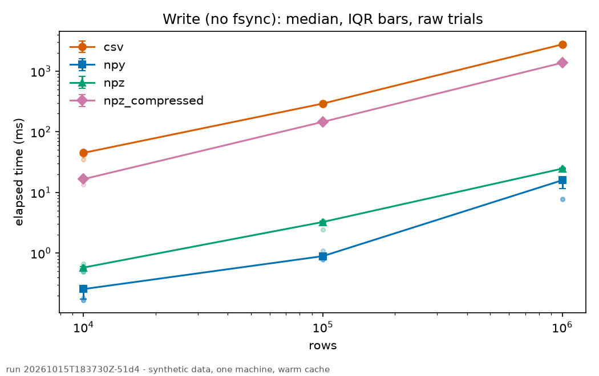
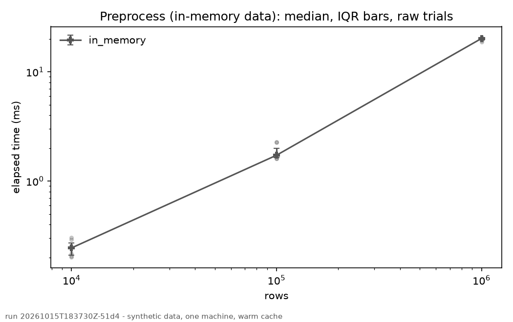
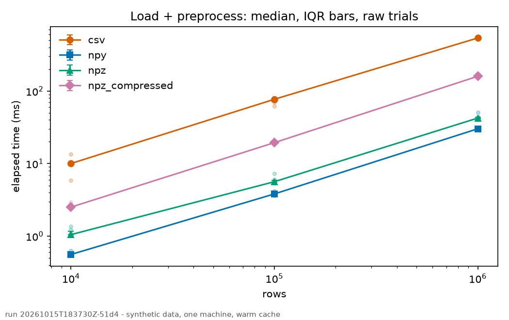
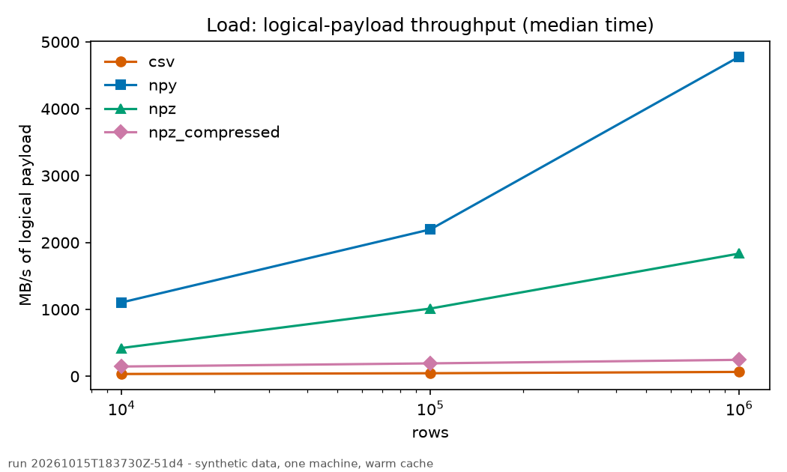
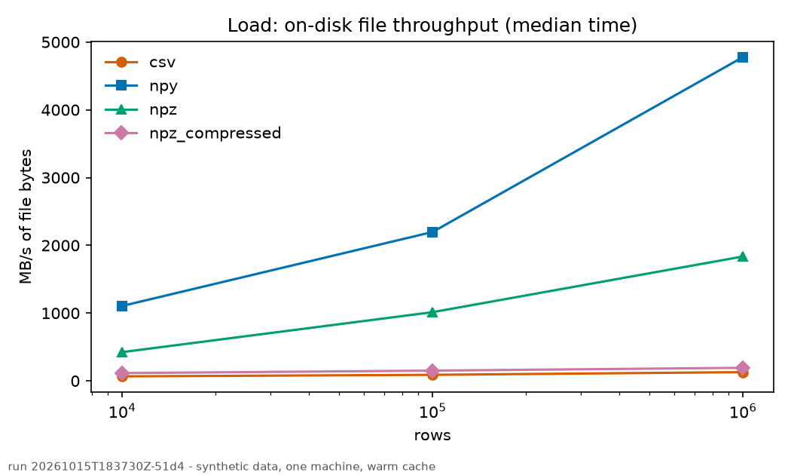
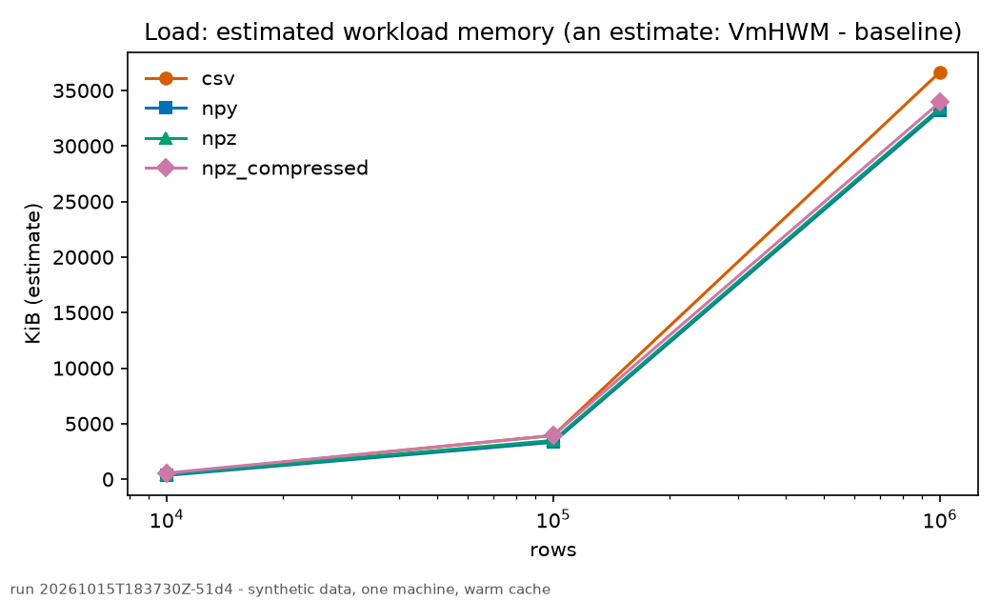

# Benchmark report - 20261015T183730Z-51d4

Generated by `sdplab report` from `trials.jsonl` and `run.json` only; nothing was re-run. Run status: **completed**.

## Conditions

| setting | value |
|---|---|
| dataset seed | 12345 |
| rows | 10,000, 100,000, 1,000,000 |
| variants | csv, npy, npz, npz_compressed |
| warm-up / measured rounds | 2 / 7 |
| order seed | 777 |
| cache mode | warm (OS page cache not cleared) |
| thread_env | inherit |
| Python / NumPy | 3.13.5 / 2.5.4 |
| OS | Linux 7.0.0-38-generic |
| CPU | 12th Gen Intel(R) Core(TM) i5-12450H (12 logical cores) |
| RAM (bytes) | 15844319232 |
| data filesystem | ext4 |
| CPU governor / power | powersave / ac |
| load average at start | [1.229, 2.218, 1.84] |
| git commit (dirty) | 2cfde3005c99a60bb39e97172b09717073586eda (True) |

## Correctness and failures

Trials recorded: 351 (warm-ups included, kept in the raw file). Failed: 0. Incorrect: 0. Every dataset and every variant passed the bit-exact pre-run gate before any trial was timed. Failed and incorrect trials are excluded from the statistics below and counted per cell.

## Write (no fsync)

Median [Q1-Q3] in ms (quantiles: linear); n = accepted/total measured trials.

| variant | 10,000 rows | 100,000 rows | 1,000,000 rows |
|---|---|---|---|
| csv | 45 [42-47.1] (n=7/7) | 293 [283-294] (n=7/7) | 2,773 [2,756-2,798] (n=7/7) |
| npy | 0.254 [0.174-0.273] (n=7/7) | 0.89 [0.833-0.93] (n=7/7) | 15.9 [11.6-16.2] (n=7/7) |
| npz | 0.577 [0.553-0.598] (n=7/7) | 3.26 [3.18-3.36] (n=7/7) | 24.7 [24.4-25.1] (n=7/7) |
| npz_compressed | 16.6 [16.5-16.7] (n=7/7) | 146 [145-151] (n=7/7) | 1,381 [1,376-1,385] (n=7/7) |

## Load

Median [Q1-Q3] in ms (quantiles: linear); n = accepted/total measured trials.

| variant | 10,000 rows | 100,000 rows | 1,000,000 rows |
|---|---|---|---|
| csv | 9.69 [9.61-11.3] (n=7/7) | 73.5 [70.8-75.2] (n=7/7) | 515 [509-518] (n=7/7) |
| npy | 0.308 [0.299-0.329] (n=7/7) | 1.55 [1.5-1.58] (n=7/7) | 7.12 [7.04-7.24] (n=7/7) |
| npz | 0.803 [0.781-0.883] (n=7/7) | 3.36 [3.28-3.44] (n=7/7) | 18.5 [18.1-19.8] (n=7/7) |
| npz_compressed | 2.32 [2.26-2.45] (n=7/7) | 17.6 [17.1-19.7] (n=7/7) | 138 [137-139] (n=7/7) |

## Preprocess (in-memory data)

Median [Q1-Q3] in ms (quantiles: linear); n = accepted/total measured trials.

| variant | 10,000 rows | 100,000 rows | 1,000,000 rows |
|---|---|---|---|
| in_memory | 0.244 [0.21-0.271] (n=7/7) | 1.72 [1.64-2] (n=7/7) | 20.2 [19.5-20.3] (n=7/7) |

## Load + preprocess

Median [Q1-Q3] in ms (quantiles: linear); n = accepted/total measured trials.

| variant | 10,000 rows | 100,000 rows | 1,000,000 rows |
|---|---|---|---|
| csv | 10 [9.97-10.2] (n=7/7) | 77.1 [71.7-77.6] (n=7/7) | 540 [528-543] (n=7/7) |
| npy | 0.559 [0.553-0.561] (n=7/7) | 3.82 [3.7-3.93] (n=7/7) | 30.2 [30-30.6] (n=7/7) |
| npz | 1.05 [1.04-1.17] (n=7/7) | 5.63 [5.48-5.91] (n=7/7) | 42.5 [41.5-43.4] (n=7/7) |
| npz_compressed | 2.51 [2.47-2.7] (n=7/7) | 19.5 [19.3-20.1] (n=7/7) | 160 [159-162] (n=7/7) |

## Throughput and memory (load)

Logical throughput = rows x 34 B / median time (same numerator for every variant). File throughput = on-disk bytes / median time (differs per variant). They are reported separately and must not be compared with each other. The memory estimate is `VmHWM - VmRSS(baseline)` per trial: an estimate, not exact workload memory.

| rows | variant | logical MB/s | file MB/s | file MB | median VmHWM KiB | estimated workload KiB |
|---|---|---|---|---|---|---|
| 10,000 | csv | 35.1 | 66 | 0.64 | 37,004 | 484 |
| 10,000 | npy | 1,104 | 1,105 | 0.34 | 36,372 | 340 |
| 10,000 | npz | 423 | 424 | 0.34 | 36,532 | 424 |
| 10,000 | npz_compressed | 147 | 114 | 0.265 | 36,696 | 548 |
| 100,000 | csv | 46.3 | 88.5 | 6.5 | 40,404 | 3,940 |
| 100,000 | npy | 2,197 | 2,197 | 3.4 | 39,384 | 3,328 |
| 100,000 | npz | 1,013 | 1,013 | 3.4 | 39,640 | 3,488 |
| 100,000 | npz_compressed | 194 | 151 | 2.65 | 40,152 | 3,936 |
| 1,000,000 | csv | 66 | 128 | 66 | 73,192 | 36,656 |
| 1,000,000 | npy | 4,779 | 4,779 | 34 | 69,356 | 33,208 |
| 1,000,000 | npz | 1,835 | 1,835 | 34 | 69,480 | 33,416 |
| 1,000,000 | npz_compressed | 247 | 192 | 26.5 | 70,116 | 33,940 |

## Flags (kept, never removed)

Trials with high load average: 0. Trials at least 3.0x their cell median: 0. Trials whose `ru_maxrss` may be floored by the parent process: 0.

## Caveats

These results come from a synthetic, HEP-inspired dataset (not real detector data) measured on one machine, with a warm OS page cache (a process restart does not clear the page cache), using CPython and NumPy. They are not representative of CERN-scale or production workloads, and this project is independent: it is not affiliated with or endorsed by CERN or CERN-HSF. Laptop power state, thermal throttling and background load affect timings; flagged trials are kept and counted, never removed. Memory figures are Linux-only process high-water marks; any figure labelled an estimate is not exact workload memory. No format is claimed to be universally fastest.
